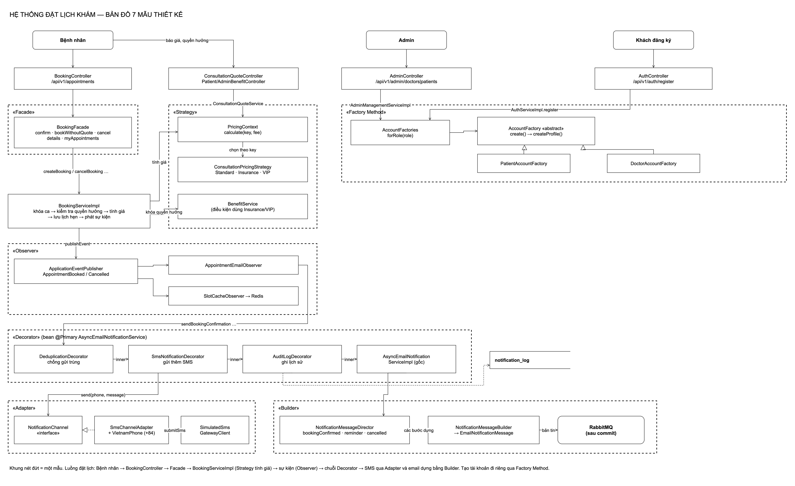

# Thiết kế lại hệ thống đặt lịch khám bằng 7 mẫu thiết kế

Hệ thống đặt lịch khám bệnh (Spring Boot + HTML/JS) được refactor để áp dụng 7 mẫu thiết kế GoF. Mỗi mẫu giải quyết một vấn đề có thật trong code đang chạy, nối vào đúng một luồng, có test chứng minh và 4 sơ đồ: class, sequence, ERD, DFD.

## Bản đồ 7 mẫu



Khung nét đứt là một mẫu. Luồng đặt lịch: Bệnh nhân → `BookingController` → **Facade** → `BookingServiceImpl` (**Strategy** tính giá) → sự kiện (**Observer**) → chuỗi **Decorator** → SMS qua **Adapter** và email dựng bằng **Builder**. Tạo tài khoản đi riêng qua **Factory Method**. Nguồn: [design-patterns-map.drawio](diagrams/design-patterns-map.drawio), sinh bằng `python3 scripts/overview/generate-map.py`.

## Các mẫu

| Mẫu | Vấn đề trước khi áp dụng | Chỗ áp dụng | Thư mục |
|---|---|---|---|
| Strategy | Giá khám chỉ có một công thức; thêm Bảo hiểm/VIP phải sửa chỗ đặt lịch | Tính phí khám: Standard, Insurance, VIP | [strategy/](strategy/) |
| Builder | Bản tin email dựng bằng constructor 9 tham số String, dễ truyền nhầm, không kiểm tra trường bắt buộc | Dựng bản tin thông báo + Director cho đặt lịch/hủy/nhắc lịch | [builder/](builder/) |
| Observer | Dịch vụ đặt lịch gọi thẳng email và cache; thêm phản ứng mới phải sửa nó | Đặt/hủy lịch phát sự kiện; observer email và observer cache phản ứng | [observer/](observer/) |
| Adapter | Không có chỗ cắm kênh SMS của nhà cung cấp có giao diện khác | Client SMS giả lập được bọc thành `NotificationChannel` | [adapter/](adapter/) |
| Decorator | Không có lịch sử thông báo, không chống gửi trùng, chỉ có email | Bọc dịch vụ thông báo: chống trùng → SMS → ghi lịch sử → email | [decorator/](decorator/) |
| Factory Method | Tạo tài khoản Bệnh nhân/Bác sĩ lặp ở đăng ký và Admin | `AccountFactory` theo vai trò, dùng chung cho đăng ký và Admin | [factory/](factory/) |
| Facade | Controller đặt lịch phải biết nhiều dịch vụ bên dưới | `BookingFacade` là cửa duy nhất của `BookingController` | [facade/](facade/) |

Mỗi thư mục có `README.md` (định nghĩa, bài toán, vai trò trong code, 4 sơ đồ, quyết định thiết kế, kiểm thử, hạn chế), `kich-ban-thuyet-trinh.md` (≈ 5 phút) và `diagrams/`.

## Thành viên

| Tên | Mẫu | Ghi chú |
|---|---|---|
| | | |
| | | |
| | | |
| | | |

## Kết quả kiểm thử (11/11/2026, nhánh `design-patterns`)

| Bộ test | Lệnh | Kết quả |
|---|---|---|
| Java, H2 | `bash scripts/maven.sh -f backend/pom.xml clean test` | 170 chạy, 0 lỗi, 17 bỏ qua (nhóm MySQL cần `CK_MYSQL_URL`) |
| Java, MySQL 8.0 thật | cùng lệnh với `CK_MYSQL_URL` (xem [report Strategy](strategy/report.md)) | 171 chạy, 0 lỗi, 0 bỏ qua |
| Nâng cấp MySQL Strategy | `python3 scripts/strategy/test-mysql-upgrades.py` | Pass |
| Nâng cấp MySQL Decorator | áp `db/upgrade/decorator/001-notification-log.sql` hai lần vào schema tạm | Pass (idempotent) |
| Node | `npm --prefix frontend test` | 14/14 |
| Trình duyệt Strategy | `python3 scripts/strategy/test-browser.py` | 17/17 |

Ghi chú: `browser-quote.cjs` từng hỏng từ 00:00 đến 07:00 giờ Việt Nam do lấy "ngày mai" theo UTC (lỗi có từ trước nhánh này); đã sửa để lấy theo giờ phòng khám.

Theo từng mẫu: Builder, Observer, Adapter, Decorator, Factory, Facade đều có test qua API (MockMvc, profile `test`) quan sát ở biên: bản tin bắt tại RabbitTemplate, SMS tại client giả lập, bảng `notification_log`, cache ghi nhận. Hai test cũ đã sửa có lý do: `BookingServiceImplTests` (kiểm tra phát sự kiện thay vì gọi email, Observer) và `AuthServiceImplTests` (thêm tham số constructor, Factory).

## Sinh lại sơ đồ

```bash
python3 scripts/<mẫu>/generate-diagrams.py
DRAWIO_BIN=/path/to/draw.io bash scripts/common/export-diagrams.sh docs/<mẫu>/diagrams
```

Mọi mẫu dùng chung bộ vẽ `scripts/common/drawio_kit.py` (đen trắng, sửa được trong draw.io).

## Spec và ticket

[Spec](../.scratch/design-patterns-redesign/spec.md) · [Danh sách ticket](../.scratch/design-patterns-redesign/tickets.md) · GitHub issue #21
