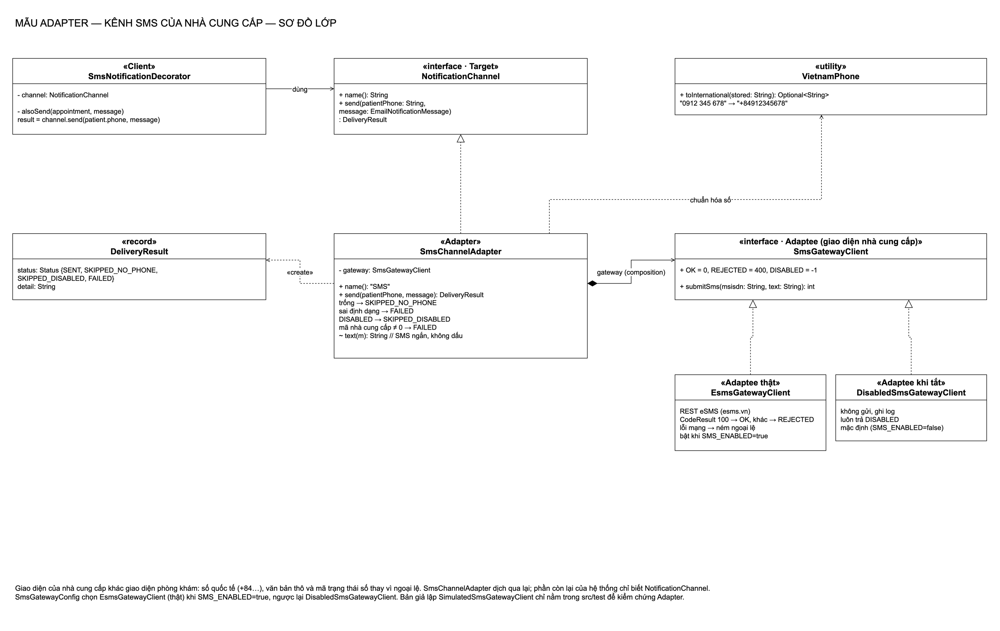
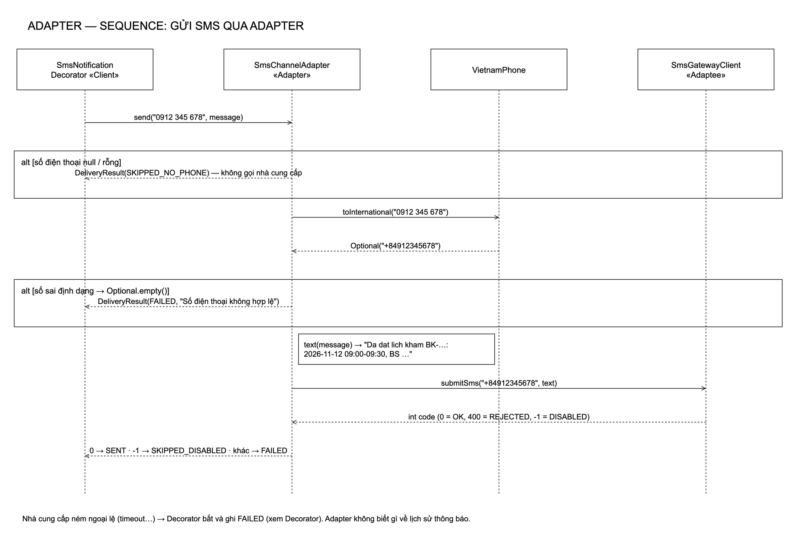
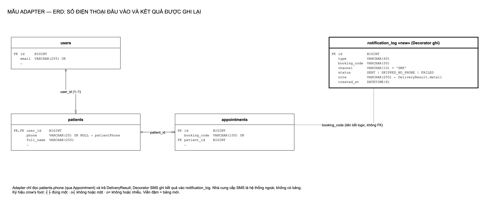
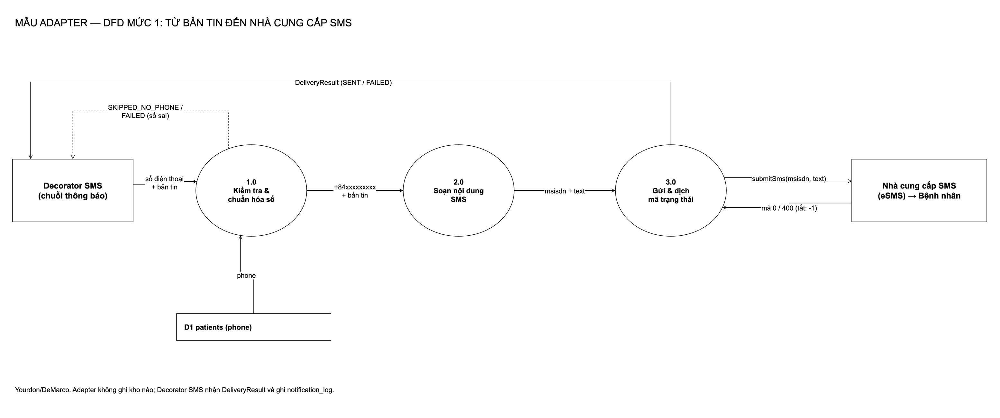
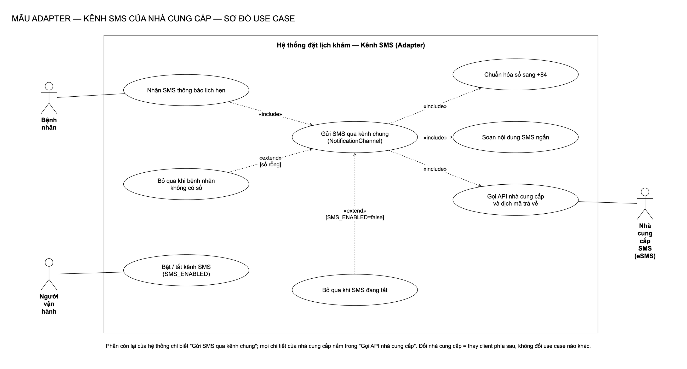

# Adapter: kênh SMS của nhà cung cấp

[← Bản đồ 7 mẫu](../README.md) · [Tài liệu chi tiết](tai-lieu-adapter.md) · [Kịch bản thuyết trình](kich-ban-thuyet-trinh.md) · [Kịch bản thuyết trình chung Adapter + Decorator](../thuyet-trinh-adapter-decorator.md) · [Lý thuyết + giải thích sơ đồ](ly-thuyet-adapter.md) · [Bản Word](../adapter-decorator.docx)

## 1. Mẫu Adapter là gì

Adapter là mẫu **cấu trúc (structural)** trong GoF: *chuyển giao diện của một lớp thành giao diện khác mà client mong đợi, để các lớp vốn không tương thích làm việc được với nhau.*

| Thành phần | Vai trò |
|---|---|
| **Target** | Giao diện client muốn dùng |
| **Adaptee** | Lớp có sẵn, giao diện khác (thường của bên thứ ba) |
| **Adapter** | Cài đặt Target, bên trong gọi Adaptee và dịch dữ liệu qua lại |
| **Client** | Chỉ biết Target |

Ví dụ ngoài đời: củ sạc du lịch. Ổ điện Việt Nam (Adaptee) và phích cắm laptop châu Âu (Client) không khớp; củ chuyển đổi (Adapter) làm chúng cắm được vào nhau mà không sửa ổ hay laptop.

## 2. Bài toán trong hệ thống

Phòng khám muốn gửi thêm SMS khi đặt/hủy/nhắc lịch. SDK của nhà cung cấp SMS có giao diện riêng:

- nhận số **quốc tế** (`+84912345678`) trong khi phòng khám lưu số kiểu `0912 345 678`;
- nhận **văn bản thô**, không biết `EmailNotificationMessage`;
- trả **mã trạng thái số** (`0`, `400`) thay vì ném ngoại lệ.

Nếu gọi thẳng SDK ở chỗ gửi thông báo, mọi chi tiết đó lan vào nghiệp vụ, và đổi nhà cung cấp là sửa nghiệp vụ.

> Nhà cung cấp thật là eSMS (`EsmsGatewayClient`, bật bằng `SMS_ENABLED=true`). Khi tắt (mặc định), `DisabledSmsGatewayClient` không gửi gì và Adapter trả `SKIPPED_DISABLED`. Bản giả lập `SimulatedSmsGatewayClient` chỉ nằm trong `src/test` để kiểm chứng Adapter.

**Phương án đã cân nhắc:**

| Phương án | Vì sao không chọn |
|---|---|
| Gọi SDK trực tiếp trong Decorator SMS | Định dạng số, mã lỗi của nhà cung cấp lẫn vào logic thông báo |
| Class adapter (kế thừa SDK) | Java chỉ kế thừa đơn; trói Adapter vào một lớp cụ thể của nhà cung cấp |
| **Object adapter (giữ SDK bên trong)** | Thay SDK bằng mock/SDK khác dễ dàng; Target là interface của phòng khám |

## 3. Thiết kế

| Vai trò | Lớp | Ghi chú |
|---|---|---|
| Target | [`NotificationChannel`](../../backend/src/main/java/com/datlichkhambenh/backend/adapter/NotificationChannel.java) | `name()`, `send(patientPhone, message): DeliveryResult` |
| Adaptee | [`SmsGatewayClient`](../../backend/src/main/java/com/datlichkhambenh/backend/adapter/SmsGatewayClient.java): [`EsmsGatewayClient`](../../backend/src/main/java/com/datlichkhambenh/backend/adapter/EsmsGatewayClient.java) (thật), [`DisabledSmsGatewayClient`](../../backend/src/main/java/com/datlichkhambenh/backend/adapter/DisabledSmsGatewayClient.java) (khi tắt) | `submitSms(msisdn, text): int` |
| Adapter | [`SmsChannelAdapter`](../../backend/src/main/java/com/datlichkhambenh/backend/adapter/SmsChannelAdapter.java) | Bỏ qua khi không có số, chuẩn hóa số, soạn SMS ngắn, dịch mã → `DeliveryResult` |
| Hỗ trợ | [`VietnamPhone`](../../backend/src/main/java/com/datlichkhambenh/backend/adapter/VietnamPhone.java), [`DeliveryResult`](../../backend/src/main/java/com/datlichkhambenh/backend/adapter/DeliveryResult.java) | `0xxx` / `84xxx` / `+84xxx` → `+84xxx`; kết quả SENT / SKIPPED_NO_PHONE / FAILED |
| Client | [`SmsNotificationDecorator`](../../backend/src/main/java/com/datlichkhambenh/backend/decorator/SmsNotificationDecorator.java) | Chỉ biết `NotificationChannel` |

## 4. Sơ đồ

| Class | Sequence |
|---|---|
|  |  |

| ERD | DFD |
|---|---|
|  |  |

**Use case**

Nguồn `.drawio` trong [diagrams/](diagrams/), sinh bằng `python3 scripts/adapter/generate-diagrams.py`.

## 5. Quyết định thiết kế

1. **Không có số điện thoại là "bỏ qua", không phải lỗi.** Số điện thoại không bắt buộc với bệnh nhân; ghi FAILED sẽ làm lịch sử đầy lỗi giả.
2. **Số sai định dạng là FAILED và không gọi nhà cung cấp.** Tiết kiệm lượt gửi; lý do ghi trong `detail`.
3. **SMS không dấu.** Tin có dấu phải mã hóa Unicode nên mỗi tin chỉ chứa khoảng 70 ký tự thay vì 160; tin không dấu ngắn gọn trong một tin.
4. **Adapter không ghi lịch sử.** Nó chỉ trả `DeliveryResult`; Decorator SMS quyết định ghi gì.

## 6. Kiểm thử

| Test | Chứng minh |
|---|---|
| [`SmsChannelAdapterTests`](../../backend/src/test/java/com/datlichkhambenh/backend/adapter/SmsChannelAdapterTests.java) | Qua bean `NotificationChannel`: nhà cung cấp nhận đúng `+84…` và nội dung có mã lịch hẹn; số địa phương được đổi; số null/rỗng → SKIPPED_NO_PHONE; số sai → FAILED; cả hai trường hợp sau đều không gọi nhà cung cấp |
| [`VietnamPhoneTests`](../../backend/src/test/java/com/datlichkhambenh/backend/adapter/VietnamPhoneTests.java) | Các dạng số phổ biến và dạng sai |
| [`SmsNotificationIntegrationTests`](../../backend/src/test/java/com/datlichkhambenh/backend/decorator/SmsNotificationIntegrationTests.java) | Qua API: bệnh nhân có số đặt lịch → nhà cung cấp nhận đúng 1 tin |

## 7. Hạn chế

- Client eSMS chưa có retry, giới hạn tốc độ hay xác nhận đã nhận tin (chỉ biết nhà cung cấp đã nhận). Chưa thử với tài khoản eSMS thật: nên thử `ESMS_SANDBOX=true` trước.
- `VietnamPhone` chỉ nhận số 10 chữ số kiểu hiện hành; số cũ 11 chữ số hay số nước ngoài bị coi là sai.
- Nội dung SMS cố định trong Adapter; muốn nhiều mẫu tin nhắn cần tách ra.
