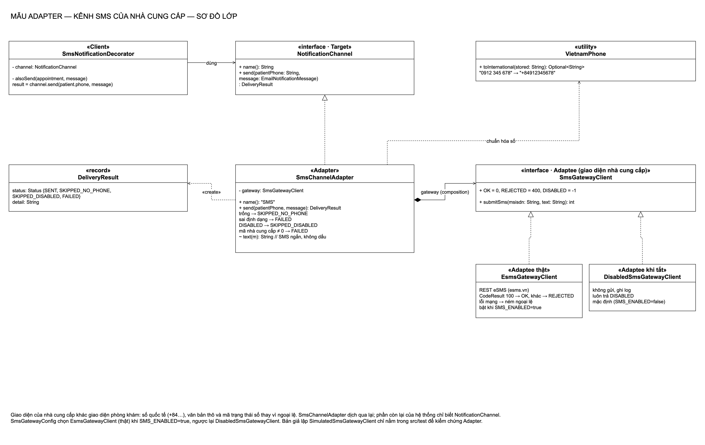
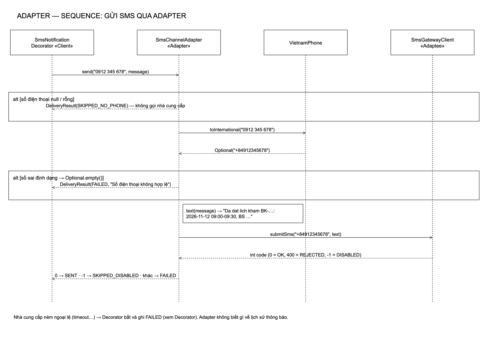
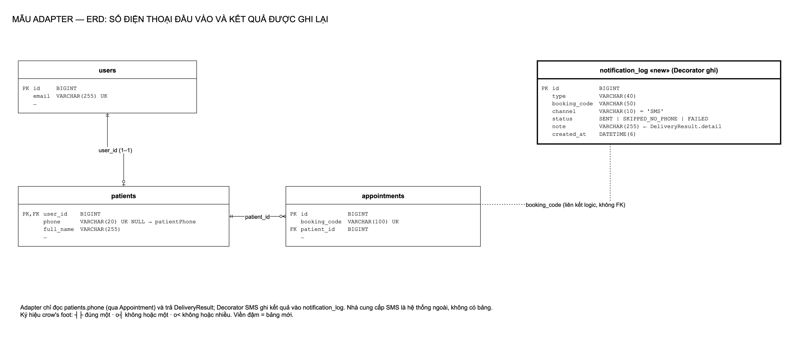
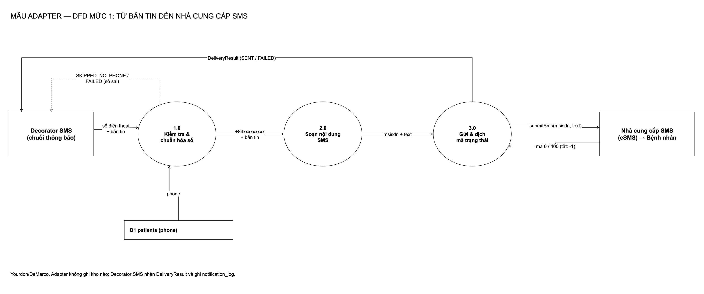
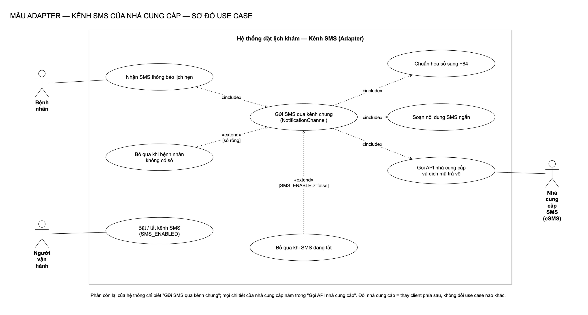

# Adapter: lý thuyết, điều kiện, cách làm trong bài và nếu không dùng thì sao

[← README Adapter](README.md) · [Tài liệu chi tiết](tai-lieu-adapter.md) · [Kịch bản thuyết trình chung](../thuyet-trinh-adapter-decorator.md) · [Lý thuyết Decorator](../decorator/ly-thuyet-decorator.md)

Tài liệu này để **học và trả lời vấn đáp**: đọc từ trên xuống là nói được mẫu Adapter từ lý thuyết tới code trong đồ án.

---

## 1. Lý thuyết

### 1.1 Định nghĩa

| Mục | Nội dung |
|---|---|
| Tên | **Adapter** (tên khác: **Wrapper**) |
| Nhóm | Mẫu **cấu trúc** (structural) trong 23 mẫu GoF (*Design Patterns*, 1994) |
| Ý định (intent) | *Chuyển giao diện của một lớp thành giao diện khác mà client mong đợi. Adapter cho phép các lớp làm việc cùng nhau, điều mà nếu không có nó thì không làm được vì giao diện không tương thích.* |
| Một câu dễ nhớ | **Không sửa bên nào, chỉ đặt một bộ chuyển đổi ở giữa.** |

### 1.2 Vấn đề gốc mà mẫu giải quyết

Trong phần mềm thật, ta thường phải dùng mã **không do mình viết**: thư viện, SDK, API của bên thứ ba, hệ thống cũ. Mã đó đúng và chạy tốt, nhưng **"nói một ngôn ngữ khác"**:

- tên hàm khác (`submitSms` thay vì `send`);
- kiểu dữ liệu khác (chuỗi thô thay vì đối tượng nghiệp vụ);
- định dạng khác (số `+84…` thay vì `0…`);
- cách báo lỗi khác (trả mã số thay vì ném ngoại lệ).

Ta có ba lựa chọn: sửa mã của họ (thường **không được**), sửa toàn bộ hệ thống mình cho khớp với họ (**tốn và gắn chặt**), hoặc **đặt một lớp ở giữa để dịch**. Lựa chọn thứ ba chính là Adapter.

### 1.3 Bốn thành phần

| Thành phần | Vai trò | Ai viết |
|---|---|---|
| **Target** | Giao diện mà client muốn dùng, theo "ngôn ngữ" của hệ thống | Mình |
| **Client** | Nơi cần dùng chức năng, chỉ biết Target | Mình |
| **Adaptee** | Lớp có sẵn, có chức năng cần dùng nhưng giao diện không khớp | Bên thứ ba / hệ thống cũ |
| **Adapter** | Hiện thực Target; nhận lời gọi theo Target, dịch rồi gọi Adaptee, dịch kết quả trả về | Mình |

**Cộng tác:** Client gọi Adapter qua Target → Adapter gọi Adaptee → Adaptee làm việc thật → Adapter dịch kết quả về dạng Target.

```
Client ──► «interface» Target ◄── Adapter ──giữ──► Adaptee
              send(...)            send(...) {          submitSms(...)
                                     dịch đầu vào
                                     adaptee.submitSms(...)
                                     dịch kết quả
                                   }
```

### 1.4 Hai biến thể (và vài biến thể phụ)

| Biến thể | Cách làm | Ưu | Nhược |
|---|---|---|---|
| **Object adapter** | Adapter **giữ** một đối tượng Adaptee (composition) | Dùng được với Adaptee và mọi lớp con của nó; thay Adaptee lúc chạy; dễ thay bằng bản giả khi test | Muốn ghi đè hành vi của Adaptee thì khó hơn |
| **Class adapter** | Adapter **kế thừa** Adaptee và hiện thực Target (đa kế thừa) | Ghi đè được hành vi của Adaptee; không cần thêm một đối tượng | Java chỉ kế thừa đơn; gắn chặt vào đúng một lớp Adaptee; không dùng được nếu Adaptee là `final` |
| Two-way adapter | Một adapter hiện thực cả hai giao diện | Hai hệ thống nhìn nhau qua cùng một đối tượng | Phức tạp, ít dùng |
| Pluggable adapter | Adapter nhận "cách dịch" từ bên ngoài (lambda, cấu hình) | Một adapter dùng cho nhiều Adaptee | Khó đọc hơn |

Đồ án dùng **object adapter**.

### 1.5 Mức độ "chuyển đổi"

GoF lưu ý: một Adapter có thể làm việc **rất ít** (chỉ đổi tên hàm) hoặc **rất nhiều** (đổi hẳn kiểu dữ liệu, thêm kiểm tra, ghép nhiều lời gọi). Adapter trong đồ án ở mức **trung bình–nhiều**: chuẩn hóa số, soạn nội dung, dịch mã kết quả, và bỏ qua những trường hợp không nên gọi nhà cung cấp.

---

## 2. Công dụng

1. **Tích hợp mã bên ngoài** mà không sửa mã đó.
2. **Cô lập phụ thuộc**: chi tiết của nhà cung cấp (định dạng số, khóa API, mã lỗi) chỉ nằm trong một chỗ.
3. **Đổi nhà cung cấp dễ dàng**: thay Adaptee, giữ nguyên Target và Client.
4. **Kiểm thử không phụ thuộc bên ngoài**: thay Adaptee thật bằng bản giả, không tốn tiền, không cần mạng.
5. **Dùng lại mã cũ** (legacy) trong hệ thống mới.
6. **Thống nhất nhiều nguồn khác nhau** dưới một giao diện (nhiều nhà cung cấp SMS, nhiều cổng thanh toán).

### Ví dụ ngoài đời

| Ví dụ | Target | Adaptee | Adapter |
|---|---|---|---|
| Củ sạc du lịch | Ổ cắm laptop mong đợi | Ổ điện Việt Nam | Củ chuyển chân cắm |
| Đầu đọc thẻ nhớ | Cổng USB | Thẻ microSD | Đầu đọc USB |
| Phiên dịch viên | Tiếng Việt | Tiếng Anh | Người phiên dịch |
| Thẻ ATM liên ngân hàng | Máy ATM ngân hàng A | Tài khoản ngân hàng B | Mạng Napas |

### Ví dụ trong Java / Spring

| Ví dụ | Target | Adaptee |
|---|---|---|
| `InputStreamReader` | `Reader` (đọc ký tự) | `InputStream` (đọc byte) |
| `Arrays.asList(array)` | `List` | Mảng |
| `Collections.enumeration(collection)` | `Enumeration` (API cũ) | `Collection` |
| Spring MVC `HandlerAdapter` | Cách `DispatcherServlet` gọi handler | Nhiều kiểu controller khác nhau |
| SLF4J bridge (`jul-to-slf4j`) | SLF4J | `java.util.logging` |

---

## 3. Điều kiện áp dụng

### 3.1 Theo GoF, dùng Adapter khi

1. Muốn dùng một lớp **có sẵn** nhưng giao diện của nó **không khớp** với cái mình cần.
2. Muốn tạo một lớp dùng lại được, làm việc với các lớp **không liên quan, không lường trước**, có giao diện không tương thích.
3. (Object adapter) Cần dùng **nhiều lớp con** có sẵn, nhưng không muốn viết lớp con cho từng cái chỉ để đổi giao diện.

### 3.2 Dấu hiệu nhận biết trong code (nên dùng Adapter)

- Nghiệp vụ có đoạn **chuyển định dạng cho bên thứ ba** (thêm `+84`, dựng JSON theo tài liệu nhà cung cấp).
- Có **"con số ma thuật"** của nhà cung cấp trong nghiệp vụ (`if (code.equals("100"))`).
- Lớp nghiệp vụ `import` thẳng SDK/HTTP client của nhà cung cấp.
- Test nghiệp vụ phải **gọi mạng thật** hoặc phải mock HTTP.
- Câu hỏi "nếu đổi nhà cung cấp thì sửa bao nhiêu file?" có câu trả lời là "nhiều".

### 3.3 Không nên dùng khi

- Giao diện hai bên **đã khớp**: Adapter chỉ chuyển tiếp, thêm lớp vô ích.
- **Mình sở hữu cả hai bên** và có thể sửa cho khớp ngay từ đầu.
- Chỉ gọi bên ngoài **một lần**, ở **một chỗ**, và chắc chắn không đổi nhà cung cấp (vẫn nên cân nhắc vì lý do kiểm thử).

### 3.4 Điều kiện để Adapter của đồ án đúng mẫu

| Điều kiện | Trong đồ án |
|---|---|
| Có Adaptee với giao diện khác, không sửa được | API eSMS: số `84…`, chuỗi văn bản, `CodeResult` |
| Có Target của hệ thống | `NotificationChannel.send(patientPhone, message)` |
| Client chỉ biết Target | `SmsNotificationDecorator` không `import` gì của eSMS |
| Adapter hiện thực Target và gọi Adaptee | `SmsChannelAdapter implements NotificationChannel`, giữ `SmsGatewayClient` |

---

## 4. Ưu điểm và nhược điểm (hệ quả của mẫu)

| Ưu điểm | Nhược điểm |
|---|---|
| Nghiệp vụ sạch, không thấy chi tiết nhà cung cấp | Thêm lớp, thêm một tầng gián tiếp |
| Đổi nhà cung cấp chỉ thay Adaptee (OCP) | Nếu Adaptee có quá nhiều chức năng, Adapter dễ thành "lớp dịch khổng lồ" |
| Test được bằng bản giả | Lỗi có thể bị "dịch mất" nếu Adapter nuốt thông tin (phải giữ chi tiết lỗi trong `detail`) |
| Một chỗ duy nhất để sửa khi nhà cung cấp đổi API | Hai lớp dịch (Adapter + client) có thể làm người mới bối rối |

---

## 5. Cách cài đặt chung (các bước)

1. **Xác định Target**: hệ thống muốn gọi gì, theo ngôn ngữ của mình (đầu vào, đầu ra, cách báo lỗi).
2. **Xác định Adaptee**: bên ngoài cung cấp gì, cần gì, trả gì.
3. **Liệt kê các điểm không khớp**: tên hàm, kiểu dữ liệu, định dạng, cách báo lỗi.
4. **Viết Adapter** hiện thực Target, giữ Adaptee (object adapter), dịch từng điểm không khớp.
5. **Cho Client chỉ phụ thuộc Target** (tiêm qua constructor).
6. **Viết bản giả của Adaptee** để kiểm thử Adapter và Client.

---

## 6. Cách làm trong bài

### 6.1 Bài toán

Phòng khám muốn gửi thêm SMS khi đặt, hủy, nhắc lịch. Nhà cung cấp eSMS:

| Điểm | Hệ thống phòng khám | eSMS |
|---|---|---|
| Số điện thoại | `0912 345 678` (có thể có dấu cách, dấu chấm) | `84912345678` |
| Dữ liệu | `EmailNotificationMessage` 9 trường | Chuỗi `Content` |
| Kết quả | Muốn biết: đã gửi / bỏ qua / lỗi | `CodeResult` (`"100"` là nhận), lỗi mạng là ngoại lệ |
| Cấu hình | Không quan tâm | `ApiKey`, `SecretKey`, `SmsType`, `Sandbox`, `IsUnicode` |

### 6.2 Ánh xạ vai trò

| Vai trò GoF | Lớp trong đồ án |
|---|---|
| Target | `adapter/NotificationChannel` |
| Adapter | `adapter/SmsChannelAdapter` |
| Adaptee (giao diện nhà cung cấp) | `adapter/SmsGatewayClient` (`OK = 0`, `REJECTED = 400`, `DISABLED = -1`) |
| Adaptee thật | `adapter/EsmsGatewayClient` (gọi REST eSMS) |
| Adaptee khi tắt | `adapter/DisabledSmsGatewayClient` |
| Adaptee giả (chỉ test) | `SimulatedSmsGatewayClient` trong `src/test` |
| Client | `decorator/SmsNotificationDecorator` |
| Chọn Adaptee | `adapter/SmsGatewayConfig` theo `SMS_ENABLED` |

### 6.3 Target: hệ thống nói gì

```java
public interface NotificationChannel {
    String name();                                              // "SMS", ghi vào lịch sử
    DeliveryResult send(String patientPhone, EmailNotificationMessage message);
}
```

Không có chữ "eSMS", không có `+84`, không có mã số nào.

### 6.4 Adapter: dịch ba chỗ

```java
public DeliveryResult send(String patientPhone, EmailNotificationMessage message) {
    if (patientPhone == null || patientPhone.isBlank()) {
        return DeliveryResult.skippedNoPhone();                // 1. không có số: bỏ qua
    }
    var msisdn = VietnamPhone.toInternational(patientPhone);   // 2. dịch số: 0912… → +84912…
    if (msisdn.isEmpty()) {
        return DeliveryResult.failed("Số điện thoại không hợp lệ: " + patientPhone);
    }
    int code = gateway.submitSms(msisdn.get(), text(message)); // 3. dịch nội dung: bản tin → chuỗi ngắn
    if (code == SmsGatewayClient.DISABLED) {
        return DeliveryResult.skippedDisabled();               // 4. dịch kết quả
    }
    return code == SmsGatewayClient.OK
            ? DeliveryResult.sent(msisdn.get())
            : DeliveryResult.failed("Nhà cung cấp SMS từ chối, mã " + code);
}
```

### 6.5 Adaptee thật: nói đúng ngôn ngữ eSMS

`EsmsGatewayClient.submitSms` bỏ dấu `+`, dựng JSON (`ApiKey`, `SecretKey`, `Phone`, `Content`, `SmsType`, `IsUnicode = 0`, `Sandbox`, `RequestId`), gửi POST, đọc `CodeResult`: `"100"` → `OK`, khác → `REJECTED`; lỗi mạng hoặc HTTP không phải 2xx → ném ngoại lệ. Thiếu khóa API → ném lỗi ngay khi khởi tạo, ứng dụng không chạy.

### 6.6 Chọn Adaptee bằng cấu hình

```java
@Bean @ConditionalOnProperty(name = "app.sms.enabled", havingValue = "true")
SmsGatewayClient esmsGatewayClient(...) { return new EsmsGatewayClient(...); }

@Bean @ConditionalOnMissingBean(SmsGatewayClient.class)
SmsGatewayClient disabledSmsGatewayClient() { return new DisabledSmsGatewayClient(); }
```

Adapter không biết đang dùng bản nào.

### 6.7 Kết quả dịch: `DeliveryResult`

| Tình huống | Có gọi nhà cung cấp? | Kết quả |
|---|:---:|---|
| Không có số | Không | `SKIPPED_NO_PHONE` |
| Số sai định dạng | Không | `FAILED` (kèm số sai) |
| SMS đang tắt | Gọi bản "tắt" | `SKIPPED_DISABLED` |
| eSMS nhận (`100`) | Có | `SENT` |
| eSMS từ chối | Có | `FAILED` (kèm mã) |
| Mạng / HTTP lỗi | Có | Ngoại lệ → Decorator ghi `FAILED` |

### 6.8 Đã kiểm chứng

24 test của Adapter pass (chạy lại ngày 13/11/2026): `SmsChannelAdapterTests` 6, `VietnamPhoneTests` 13, `EsmsGatewayClientTests` 4 (máy chủ HTTP giả lập đúng định dạng eSMS), `DisabledSmsChannelTests` 1.

---

## 7. Nếu không dùng Adapter thì sao

### 7.1 Code sẽ trông thế nào (minh họa, không có trong đồ án)

Nếu gọi thẳng eSMS trong lớp gửi thông báo:

```java
// MINH HỌA "KHÔNG DÙNG ADAPTER": chi tiết eSMS nằm ngay trong nghiệp vụ
private void alsoSendSms(Appointment a, EmailNotificationMessage m) {
    String phone = a.getPatient().getPhone().replaceAll("[\\s.\\-]", "");
    if (phone.startsWith("0")) phone = "84" + phone.substring(1);       // định dạng của eSMS
    Map<String, String> body = Map.of("ApiKey", apiKey, "SecretKey", secretKey,
            "Phone", phone, "Content", "Da dat lich " + m.bookingCode(),
            "SmsType", "8", "IsUnicode", "0");                         // tên trường của eSMS
    String reply = http.post(ESMS_URL, json(body));                     // gọi mạng ngay đây
    if (!json(reply).get("CodeResult").equals("100")) {                 // mã của eSMS
        log.warn("SMS lỗi");
    }
}
```

### 7.2 Chuyện gì sẽ xảy ra

| # | Tình huống | Không có Adapter | Có Adapter (đồ án) |
|---|---|---|---|
| 1 | **Đổi nhà cung cấp** (eSMS tăng giá, chuyển sang nhà khác) | Sửa lớp thông báo, và mọi nơi khác cũng gọi eSMS; sửa nghiệp vụ chỉ vì chuyện hạ tầng | Viết một lớp `SmsGatewayClient` mới, đổi bean. Adapter, Decorator, đặt lịch không đổi |
| 2 | **Viết test** | Test gọi eSMS thật: **tốn tiền mỗi lần chạy**, cần mạng, cần khóa API; hoặc phải mock HTTP rất rườm rà | Thay Adaptee bằng bản giả trong bộ nhớ; 24 test chạy trong vài giây, không tốn đồng nào |
| 3 | **Định dạng số** | Mỗi chỗ tự chuẩn hóa một kiểu, dễ lệch (chỗ quên bỏ dấu chấm, chỗ thêm `84` hai lần) | Một hàm `VietnamPhone.toInternational`, 13 test |
| 4 | **Bệnh nhân không có số** | Dễ gọi eSMS với số rỗng → mất lượt gửi, log đầy lỗi giả | `SKIPPED_NO_PHONE`, không gọi |
| 5 | **Tắt SMS khi demo / khi hết tiền** | Phải rải `if (smsEnabled)` ở mọi chỗ gửi; quên một chỗ là gửi thật | Đổi một cờ `SMS_ENABLED`, cấu hình tự chọn bản "tắt" |
| 6 | **Quên khóa API khi triển khai** | Chỉ phát hiện khi bệnh nhân đầu tiên đặt lịch | Ứng dụng không khởi động, báo thiếu khóa ngay |
| 7 | **eSMS đổi API** (đổi tên trường, đổi mã) | Tìm và sửa trong nghiệp vụ | Sửa đúng `EsmsGatewayClient` |
| 8 | **Thêm kênh khác** (Zalo) | Thêm một khối code tương tự, nghiệp vụ biết thêm một nhà cung cấp | Thêm một Adapter khác cũng hiện thực `NotificationChannel` |
| 9 | **Đọc code nghiệp vụ** | Lẫn lộn chuyện "gửi thông báo cho bệnh nhân" với chuyện "JSON của eSMS trông thế nào" | Nghiệp vụ chỉ còn `channel.send(phone, message)` |

### 7.3 Vi phạm nguyên tắc nào

| Nguyên tắc | Bị vi phạm thế nào khi không dùng Adapter |
|---|---|
| **SRP** | Lớp thông báo vừa lo nghiệp vụ, vừa lo định dạng số, vừa lo HTTP, vừa lo mã lỗi eSMS |
| **OCP** | Đổi nhà cung cấp phải **sửa** lớp đang chạy thay vì **thêm** lớp mới |
| **DIP** | Nghiệp vụ (cấp cao) phụ thuộc trực tiếp eSMS (chi tiết cấp thấp) |
| **ISP** | Nghiệp vụ phải biết cả `ApiKey`, `SmsType`, `Sandbox`, những thứ nó không cần |

---

## 8. So sánh với các mẫu dễ nhầm

| Mẫu | Giống Adapter ở | Khác ở |
|---|---|---|
| **Decorator** | Cũng bọc một đối tượng | Decorator **giữ nguyên** giao diện và **thêm hành vi**; Adapter **đổi** giao diện |
| **Facade** | Cũng đứng giữa client và mã khác | Facade **gom nhiều** lớp thành một cửa đơn giản hơn; Adapter đổi **một** giao diện cho khớp |
| **Proxy** | Cũng đứng trước một đối tượng | Proxy **cùng** giao diện, kiểm soát truy cập (lười tải, phân quyền, từ xa) |
| **Bridge** | Cũng tách giao diện khỏi hiện thực | Bridge thiết kế **từ đầu** để hai phía phát triển độc lập; Adapter dùng **sau khi** đã có hai bên không khớp |
| **Strategy** | Cũng thay được phía sau một giao diện | Strategy là các **thuật toán cùng mục đích** do mình viết; Adaptee là mã **bên ngoài** có giao diện khác |

Trong đồ án, `SmsGatewayClient` có nhiều bản thay nhau (thật, tắt, giả) trông giống Strategy, nhưng **mục đích** là che nhà cung cấp bên ngoài, nên vai trò đúng là Adaptee.

---

## 9. SOLID trong Adapter của đồ án

| Nguyên tắc | Biểu hiện |
|---|---|
| **S**RP | Adapter chỉ dịch; client eSMS chỉ gọi HTTP; Decorator chỉ quyết định khi nào gửi và ghi gì |
| **O**CP | Thêm nhà cung cấp = thêm lớp `SmsGatewayClient`, không sửa lớp cũ |
| **L**SP | Bản thật, bản tắt, bản giả thay nhau được mà Adapter vẫn đúng |
| **I**SP | `NotificationChannel` chỉ có 2 hàm |
| **D**IP | Decorator phụ thuộc `NotificationChannel`; Adapter phụ thuộc `SmsGatewayClient`; không ai phụ thuộc eSMS ngoài đúng một lớp |

---

## 10. Câu hỏi vấn đáp khó

| Câu hỏi | Trả lời |
|---|---|
| Adapter trong bài có phải chỉ là "một lớp gọi API"? | Không. Nó hiện thực một giao diện **của phòng khám** (`NotificationChannel`) và dịch **ba** điểm không khớp (số, nội dung, kết quả) sang giao diện **của nhà cung cấp**. Client không biết eSMS tồn tại. |
| Tại sao có hai lớp dịch (Adapter và `EsmsGatewayClient`)? | `SmsGatewayClient` là "hình dạng chung của một nhà cung cấp SMS" (số quốc tế, chuỗi, mã số). `EsmsGatewayClient` dịch từ hình dạng chung đó sang chi tiết riêng eSMS (JSON, `CodeResult = "100"`). Đổi nhà cung cấp chỉ viết lại lớp thứ hai; luật nghiệp vụ trong Adapter (bỏ qua khi không có số…) giữ nguyên. |
| Sao không để Adapter ném ngoại lệ khi không có số? | Không có số là **tình huống bình thường** (số không bắt buộc). Ngoại lệ dành cho chuyện bất thường. |
| Sao số sai thì FAILED mà không có số thì SKIPPED? | Không có số: hệ thống không có gì để gửi, không ai sai. Số sai: dữ liệu bẩn, cần người xem lại, nên ghi là lỗi. |
| Class adapter có dùng được không? | Không hợp: Java kế thừa đơn, Adapter sẽ gắn chặt vào một lớp eSMS, không thay bằng bản giả hay bản tắt được. |
| Nếu eSMS trả về thành công nhưng bệnh nhân không nhận tin? | Adapter chỉ biết nhà cung cấp **đã nhận**. Biết bệnh nhân đã nhận cần thêm cơ chế báo nhận (delivery report) của eSMS, chưa làm. |
| Đã gửi SMS thật chưa? | Chưa. Đã kiểm thử bằng máy chủ HTTP giả lập đúng định dạng eSMS; bước tiếp là bật `ESMS_SANDBOX=true`. |

---

## 11. Giải thích sơ đồ

Năm sơ đồ nằm trong `docs/adapter/diagrams/`, sinh bằng `python3 scripts/adapter/generate-diagrams.py`.

### 11.1 Sơ đồ lớp (Class diagram)



**Mục đích:** cho thấy **ai đóng vai gì** trong mẫu Adapter và các lớp nối với nhau ra sao.

**Cách đọc ký hiệu:**

| Ký hiệu | Ý nghĩa |
|---|---|
| `«interface · Target»`, `«Adapter»`… | Stereotype: vai trò của lớp trong mẫu GoF |
| Nét đứt, đầu tam giác rỗng | **Hiện thực** (implements) một interface |
| Nét liền, đầu kim cương đặc | **Composition**: lớp này giữ (sở hữu) lớp kia bên trong |
| Nét liền, đầu mũi tên mở, chữ "dùng" | **Phụ thuộc / sử dụng** |
| Nét đứt, chữ «create» | Lớp này **tạo** đối tượng của lớp kia |
| `+` / `-` / `~` | public / private / package-private |

**Đọc từng phần (trái sang phải, trên xuống dưới):**

1. **`SmsNotificationDecorator` «Client»** (trên trái): giữ một trường `channel: NotificationChannel` và gọi `channel.send(patient.phone, message)`. Mũi tên "dùng" chỉ sang **Target**, không chỉ sang eSMS: Client không biết nhà cung cấp nào phía sau.
2. **`NotificationChannel` «interface · Target»** (trên giữa): giao diện của phòng khám, chỉ có `name()` và `send(patientPhone, message): DeliveryResult`.
3. **`SmsChannelAdapter` «Adapter»** (giữa): mũi tên nét đứt tam giác rỗng đi **lên** Target nghĩa là Adapter **hiện thực** Target. Trong thân lớp ghi sẵn 4 quy tắc dịch: trống → `SKIPPED_NO_PHONE`; sai định dạng → `FAILED`; `DISABLED` → `SKIPPED_DISABLED`; mã khác 0 → `FAILED`; và hàm `text(m)` soạn SMS ngắn không dấu.
4. **Kim cương đặc từ Adapter sang `SmsGatewayClient`**, chữ "gateway (composition)": Adapter **giữ** Adaptee bên trong. Đây là dấu hiệu nhận biết **object adapter** (không phải kế thừa).
5. **`SmsGatewayClient` «interface · Adaptee»** (phải giữa): giao diện "kiểu nhà cung cấp": hằng số `OK = 0, REJECTED = 400, DISABLED = -1` và `submitSms(msisdn, text): int`. Nhìn là thấy khác Target: nhận số quốc tế và chuỗi, trả **số nguyên** chứ không trả đối tượng kết quả.
6. **Hai lớp dưới cùng bên phải** hiện thực Adaptee: **`EsmsGatewayClient` «Adaptee thật»** gọi REST eSMS, `CodeResult 100 → OK`, lỗi mạng ném ngoại lệ, bật khi `SMS_ENABLED=true`; **`DisabledSmsGatewayClient` «Adaptee khi tắt»** không gửi, luôn trả `DISABLED`, là mặc định.
7. **`VietnamPhone` «utility»** (trên phải): Adapter gọi nó để chuẩn hóa số (`"0912 345 678" → "+84912345678"`), mũi tên nét đứt "chuẩn hóa số".
8. **`DeliveryResult` «record»** (trái giữa): Adapter **tạo** (`«create»`) kết quả với 4 trạng thái `SENT, SKIPPED_NO_PHONE, SKIPPED_DISABLED, FAILED` và `detail`.

**Điểm cần nói khi trình bày:** "Nhìn sơ đồ, mũi tên của Client chỉ dừng ở Target. Mọi thứ của eSMS nằm ở góc phải dưới, sau Adapter. Muốn đổi nhà cung cấp, em chỉ thêm một hộp mới cạnh `EsmsGatewayClient`, không động vào bên trái."

### 11.2 Sơ đồ tuần tự (Sequence diagram)



**Mục đích:** cho thấy **thứ tự lời gọi theo thời gian** khi gửi một SMS, và các nhánh rẽ.

**Cách đọc ký hiệu:**

| Ký hiệu | Ý nghĩa |
|---|---|
| Hộp trên cùng + đường đứt dọc | Một đối tượng (lifeline); thời gian đi từ trên xuống |
| Mũi tên liền | Lời gọi hàm |
| Mũi tên nét đứt | Giá trị trả về |
| Khung `alt [điều kiện]` | Nhánh chỉ chạy khi điều kiện đúng |
| Hộp chữ nhật trên lifeline | Ghi chú việc xảy ra bên trong đối tượng |

**Bốn đối tượng, trái sang phải:** `SmsNotificationDecorator` «Client» → `SmsChannelAdapter` «Adapter» → `VietnamPhone` → `SmsGatewayClient` «Adaptee».

**Đọc từ trên xuống:**

1. Client gọi `send("0912 345 678", message)` trên Adapter. Số vẫn ở **dạng phòng khám lưu**.
2. **Khung `alt [số điện thoại null / rỗng]`**: Adapter trả ngay `DeliveryResult(SKIPPED_NO_PHONE)`, **không gọi nhà cung cấp**. Lifeline của Adaptee không có mũi tên nào trong khung này.
3. Nếu có số, Adapter gọi `toInternational("0912 345 678")` trên `VietnamPhone`, nhận về `Optional("+84912345678")`.
4. **Khung `alt [số sai định dạng → Optional.empty()]`**: trả `DeliveryResult(FAILED, "Số điện thoại không hợp lệ")`, cũng **không gọi** nhà cung cấp.
5. Ghi chú `text(message) → "Da dat lich kham BK-…: 2026-11-12 09:00-09:30, BS …"`: Adapter soạn tin ngắn từ bản tin 9 trường.
6. Adapter gọi `submitSms("+84912345678", text)` trên Adaptee: **đây là chỗ duy nhất** chạm tới nhà cung cấp.
7. Adaptee trả `int code (0 = OK, 400 = REJECTED, -1 = DISABLED)`.
8. Adapter dịch mã về cho Client: `0 → SENT`, `-1 → SKIPPED_DISABLED`, khác → `FAILED`.

**Chú thích cuối sơ đồ:** nếu nhà cung cấp ném ngoại lệ (timeout…) thì **Decorator** bắt và ghi `FAILED`; Adapter không biết gì về lịch sử thông báo.

**Điểm cần nói:** "Hai khung `alt` là hai lần Adapter **bảo vệ** nhà cung cấp khỏi lời gọi vô ích. Chỉ khi số hợp lệ, mũi tên mới đi tới cột ngoài cùng bên phải."

### 11.3 Sơ đồ thực thể – liên kết (ERD)



**Mục đích:** cho thấy Adapter **đọc dữ liệu gì** và kết quả **được lưu ở đâu**.

**Cách đọc ký hiệu crow's foot (ghi ở chân sơ đồ):**

| Ký hiệu | Ý nghĩa |
|---|---|
| `┼┼` (hai vạch) | Đúng một |
| `o┼` (vòng + vạch) | Không hoặc một |
| `o<` (vòng + chân chim) | Không hoặc nhiều |
| Nét đứt | Liên kết logic, **không có khóa ngoại** |
| Viền đậm | Bảng mới |
| `PK`, `FK`, `UK` | Khóa chính, khóa ngoại, duy nhất |

**Đọc từng bảng:**

1. **`users`**: tài khoản đăng nhập (`id`, `email`).
2. **`patients`**: nối 1–1 với `users` qua `user_id` (vừa là PK vừa là FK). Cột **`phone VARCHAR(20) UK NULL → patientPhone`** là **đầu vào duy nhất** của Adapter. Chú ý `NULL`: số không bắt buộc, nên Adapter phải có nhánh `SKIPPED_NO_PHONE`.
3. **`appointments`**: mỗi bệnh nhân có 0..n lịch hẹn (`patient_id`), có `booking_code` duy nhất.
4. **`notification_log «new» (Decorator ghi)`** (viền đậm): kết quả SMS được ghi ở đây với `channel = 'SMS'`, `status` là một trong `SENT | SKIPPED_NO_PHONE | SKIPPED_DISABLED | FAILED`, và `note ← DeliveryResult.detail`.
5. **Đường nét đứt `booking_code (liên kết logic, không FK)`** nối `appointments` với `notification_log`.

**Điểm cần nói:** "Adapter **không có bảng riêng** và **không ghi gì** vào DB. Nó chỉ đọc số điện thoại và trả kết quả. Người ghi là Decorator. Nhà cung cấp SMS là hệ thống ngoài nên không có bảng nào."

### 11.4 Sơ đồ luồng dữ liệu mức 1 (DFD)



**Mục đích:** cho thấy **dữ liệu biến đổi qua từng bước** từ bản tin tới nhà cung cấp, không quan tâm lớp nào.

**Cách đọc ký hiệu (Yourdon/DeMarco):**

| Ký hiệu | Ý nghĩa |
|---|---|
| Hình chữ nhật | Tác nhân ngoài (external entity) |
| Hình tròn có số | Tiến trình (process) biến đổi dữ liệu |
| Hình chữ nhật hở bên phải, có `D1` | Kho dữ liệu (data store) |
| Mũi tên có nhãn | Dòng dữ liệu |

**Đọc trái sang phải:**

1. **Tác nhân "Decorator SMS (chuỗi thông báo)"** gửi vào **số điện thoại + bản tin**.
2. **Tiến trình 1.0 "Kiểm tra & chuẩn hóa số"** đọc thêm `phone` từ kho **D1 patients**. Có hai lối ra:
   - lối chính: `+84xxxxxxxxx + bản tin` đi tiếp sang 2.0;
   - lối tắt nét đứt quay về Decorator: `SKIPPED_NO_PHONE / FAILED (số sai)`.
3. **Tiến trình 2.0 "Soạn nội dung SMS"** biến bản tin 9 trường thành `msisdn + text`.
4. **Tiến trình 3.0 "Gửi & dịch mã trạng thái"** gửi `submitSms(msisdn, text)` tới tác nhân **"Nhà cung cấp SMS (eSMS) → Bệnh nhân"**, nhận lại `mã 0 / 400 (tắt: -1)`.
5. Mũi tên dài trên cùng: 3.0 trả `DeliveryResult (SENT / FAILED)` về Decorator.

**Ánh xạ tiến trình → code:** 1.0 = `VietnamPhone.toInternational` + kiểm tra rỗng; 2.0 = `SmsChannelAdapter.text`; 3.0 = `gateway.submitSms` + khối dịch mã.

**Điểm cần nói:** "Ba vòng tròn chính là ba việc dịch của Adapter: dịch số, dịch nội dung, dịch kết quả. Chú thích cuối ghi rõ: Adapter không ghi kho nào."

### 11.5 Sơ đồ use case



**Mục đích:** cho thấy **ai dùng** kênh SMS và **chức năng nào** liên quan, nhìn từ phía người dùng.

**Cách đọc ký hiệu:**

| Ký hiệu | Ý nghĩa |
|---|---|
| Hình người | Tác nhân (actor) |
| Hình elip | Use case (chức năng) |
| Khung chữ nhật lớn | Ranh giới hệ thống |
| Nét liền không mũi tên | Tác nhân tham gia use case |
| `«include»` nét đứt | Use case gốc **luôn** gọi use case được include |
| `«extend» [điều kiện]` nét đứt | Use case mở rộng **chỉ chạy khi** điều kiện đúng; mũi tên chỉ **về** use case gốc |

**Đọc sơ đồ:**

1. **Ba tác nhân:** **Bệnh nhân** (trái trên), **Người vận hành** (trái dưới), **Nhà cung cấp SMS (eSMS)** (phải, ngoài hệ thống).
2. Bệnh nhân tham gia **"Nhận SMS thông báo lịch hẹn"**, use case này «include» **"Gửi SMS qua kênh chung (NotificationChannel)"**.
3. "Gửi SMS qua kênh chung" «include» ba việc luôn xảy ra: **"Chuẩn hóa số sang +84"**, **"Soạn nội dung SMS ngắn"**, **"Gọi API nhà cung cấp và dịch mã trả về"**. Chỉ use case cuối nối với tác nhân eSMS.
4. Hai «extend» về "Gửi SMS qua kênh chung":
   - **"Bỏ qua khi bệnh nhân không có số"** với điều kiện `[số rỗng]`;
   - **"Bỏ qua khi SMS đang tắt"** với điều kiện `[SMS_ENABLED=false]`.
5. Người vận hành tham gia **"Bật / tắt kênh SMS (SMS_ENABLED)"**.

**Điểm cần nói:** "Phần còn lại của hệ thống chỉ biết 'Gửi SMS qua kênh chung'. Mọi chi tiết của nhà cung cấp nằm trong một elip 'Gọi API nhà cung cấp'. Đổi nhà cung cấp là thay client phía sau, không đổi use case nào khác."
