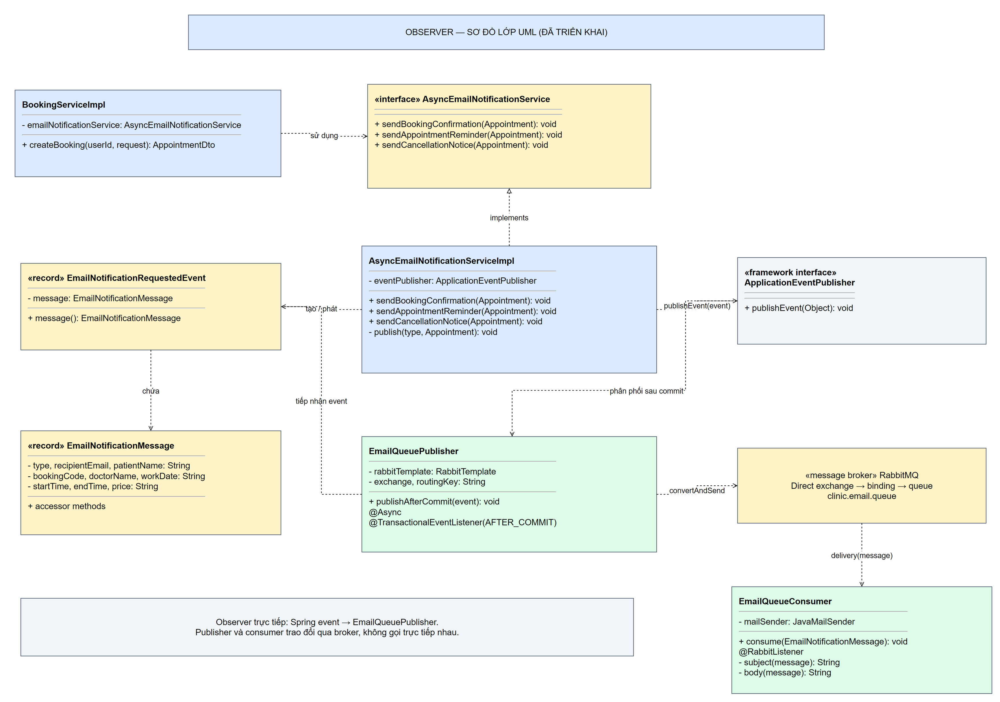
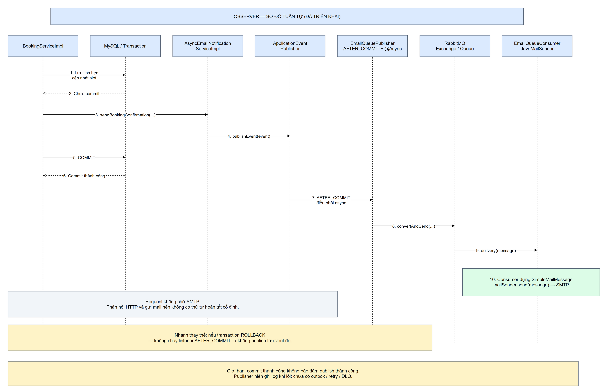
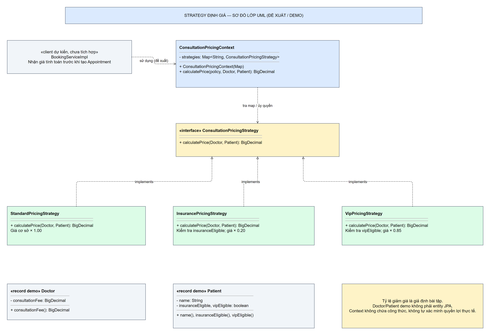
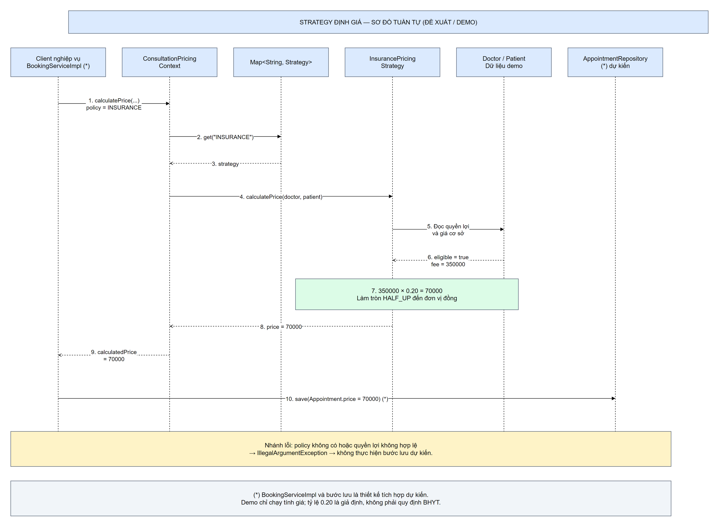

# 3.4. Các mẫu thuộc nhóm Behavioral (Mẫu hành vi)

Các mẫu thiết kế hành vi tập trung vào cách các đối tượng trao đổi thông tin, phân chia trách nhiệm và phối hợp thực hiện tác vụ. Trong hệ thống đặt lịch khám bệnh, nhóm này được vận dụng để giải quyết hai vấn đề: tách xử lý thông báo email khỏi nghiệp vụ đặt lịch và tổ chức các công thức tính phí khám có khả năng thay thế, mở rộng.

Phần này phân tích **Observer Pattern đã có trong backend** và **Strategy Pattern cho định giá ở mức thiết kế đề xuất, có code demo độc lập**. Việc phân biệt trạng thái giúp đối chiếu chính xác giữa thiết kế và hệ thống đang chạy: hiện tại backend vẫn lấy trực tiếp phí khám của bác sĩ, chưa tích hợp các chính sách giá trong đề xuất.

## 3.4.1. Mẫu thứ nhất: Observer Pattern

### 1. Bài toán và vị trí áp dụng

**Vị trí áp dụng:** package `com.datlichkhambenh.backend.messaging`, với các lớp `EmailNotificationRequestedEvent`, `EmailNotificationMessage`, `EmailQueuePublisher`, `EmailQueueConsumer`; lớp `AsyncEmailNotificationServiceImpl` thuộc tầng service. Điểm gọi nghiệp vụ nằm trong `BookingServiceImpl.createBooking(...)`.

Sau khi bệnh nhân đặt lịch thành công, hệ thống cần gửi email xác nhận chứa mã lịch hẹn, bác sĩ, thời gian và phí khám. Nếu dịch vụ đặt lịch gọi SMTP đồng bộ, request phải chờ máy chủ mail xử lý. Khi mạng chậm hoặc SMTP quá tải, thời gian phản hồi kéo dài. Độ trễ cụ thể phụ thuộc môi trường, vì vậy báo cáo không gán một khoảng thời gian cố định khi chưa đo thực nghiệm.

Một vấn đề khác là thời điểm gửi mail. Nếu email được gửi trước khi transaction database hoàn tất, hệ thống có thể thông báo xác nhận rồi sau đó rollback lịch hẹn. Ngược lại, nếu lỗi SMTP được truyền ngược ra ngoài trong transaction mà không có cách xử lý phù hợp, tác vụ thông báo có thể ảnh hưởng đến nghiệp vụ đặt lịch.

Yêu cầu đặt ra là tách trách nhiệm phát yêu cầu thông báo khỏi trách nhiệm gửi email, đồng thời chỉ chuyển yêu cầu sang hàng đợi sau khi dữ liệu được commit thành công.

### 2. Lý do lựa chọn mẫu

Observer thiết lập quan hệ giữa bên phát thông báo và các thành phần quan tâm đến thông báo. Bên phát không phải gọi trực tiếp từng lớp thực hiện phản ứng. Trong dự án, Spring application event đảm nhiệm đăng ký và phân phối sự kiện; dịch vụ thông báo chỉ phát `EmailNotificationRequestedEvent`, còn listener thực hiện công việc đưa message vào RabbitMQ.

Observer phù hợp vì gửi mail là một phản ứng phát sinh từ nghiệp vụ đặt lịch. Khi thêm một nhu cầu như ghi nhận sự kiện hoặc gửi SMS, có thể bổ sung listener phù hợp thay vì đưa toàn bộ logic vào `BookingServiceImpl`.

Cần phân biệt ba cơ chế: **Observer** giúp tách bên phát và bên nhận; **transactional listener** quy định thời điểm xử lý sau commit; **async và RabbitMQ** hỗ trợ chuyển công việc ra khỏi đường chờ SMTP của request. Observer tự nó không bảo đảm bất đồng bộ hoặc giao nhận tin cậy đầu cuối. Spring event trong ứng dụng và thông điệp qua RabbitMQ là hai chặng khác nhau.

### 3. Các thành phần tham gia

| Vai trò | Thành phần | Trách nhiệm |
| --- | --- | --- |
| Client nghiệp vụ | `BookingServiceImpl` | Kiểm tra, lưu lịch hẹn và yêu cầu gửi xác nhận trong transaction |
| Subject/Publisher ở mức ứng dụng | `AsyncEmailNotificationServiceImpl` | Dựng message và phát sự kiện qua `ApplicationEventPublisher` |
| Cơ chế phân phối | Spring `ApplicationEventPublisher` | Chuyển sự kiện đến listener tương ứng |
| Event | `EmailNotificationRequestedEvent` | Bao gói `EmailNotificationMessage` |
| Dữ liệu thông báo | `EmailNotificationMessage` | Chứa các giá trị cần để dựng email, không chuyển nguyên entity JPA |
| Observer/Listener | `EmailQueuePublisher` | Xử lý sau commit; chạy nền để chuyển message sang RabbitMQ |
| Message broker | RabbitMQ exchange, binding, queue | Định tuyến và lưu message chờ consumer |
| Message consumer | `EmailQueueConsumer` | Nhận message từ queue, dựng `SimpleMailMessage` và gọi `JavaMailSender` |

Consumer là thành phần xử lý chặng sau broker, không trực tiếp quan sát Spring application event. Trong code hiện tại, tên phương thức nhận message là `consume(...)` và lớp nghiệp vụ là `BookingServiceImpl`; không có yêu cầu phải tạo thêm `BookingFacadeImpl` để trình bày mẫu này.

### 4. Sơ đồ lớp UML



**Hình 3.4.1.** Sơ đồ lớp thể hiện interface dịch vụ thông báo, implementation, event, listener và consumer. Mũi tên hiện thực hóa nối implementation với interface; quan hệ phụ thuộc thể hiện bên phát sử dụng event và listener tiếp nhận event. RabbitMQ được biểu diễn như thành phần trung gian để tránh hiểu nhầm publisher gọi trực tiếp consumer.

File chỉnh sửa: [Observer.drawio — trang Class Diagram](01-observer/Observer.drawio).

### 5. Sơ đồ tuần tự



**Hình 3.4.2.** Sự kiện được phát trong transaction, nhưng việc chuyển message sang broker chỉ được thực hiện bởi listener sau commit. Gửi SMTP diễn ra tại consumer. Nhánh rollback không thực hiện listener `AFTER_COMMIT`. Phản hồi HTTP không phải chờ SMTP; thứ tự tương đối giữa phản hồi HTTP và hoàn tất gửi email không được bảo đảm.

File chỉnh sửa: [Observer.drawio — trang Sequence Diagram](01-observer/Observer.drawio).

### 6. Giải thích luồng hoạt động

**Bước 1:** `BookingServiceImpl.createBooking(...)` chạy trong `@Transactional`, khóa slot, kiểm tra điều kiện đặt lịch, lưu `Appointment` và cập nhật `Schedule`. Cơ chế khóa giải quyết tranh chấp giữa các bệnh nhân; đây là trách nhiệm riêng với Observer.

**Bước 2:** service gọi `sendBookingConfirmation(savedAppointment)`. Implementation tạo message loại `BOOKING_CONFIRMED`, chụp dữ liệu cần gửi từ lịch hẹn và phát `EmailNotificationRequestedEvent`.

**Bước 3:** Spring gắn việc xử lý của `EmailQueuePublisher` với phase `AFTER_COMMIT`. Khi transaction rollback, listener ở phase này không chạy. Khi transaction commit, lời gọi listener được điều phối qua cơ chế `@Async`.

**Bước 4:** publisher gọi `RabbitTemplate.convertAndSend(exchange, routingKey, message)`. Cấu hình hiện tại dùng exchange `clinic.email.exchange`, routing key `clinic.email.send` và queue `clinic.email.queue`.

**Bước 5:** `EmailQueueConsumer.consume(...)` nhận message bằng `@RabbitListener`, chọn tiêu đề/nội dung theo loại thông báo và gọi `JavaMailSender.send(...)`. Dữ liệu message đã có sẵn nên consumer không cần truy cập các quan hệ JPA của lịch hẹn.

Nếu phát event ngoài transaction, listener hiện không bật `fallbackExecution` nên không tự động thực hiện. Nếu đã commit nhưng broker lỗi, lịch hẹn vẫn tồn tại; code publisher hiện chỉ ghi log khi publish thất bại. Vì vậy, “đặt lịch thành công” và “email đã được gửi” là hai kết quả cần quan sát riêng.

### 7. Đoạn mã tiêu biểu

Điểm phát sự kiện trong `AsyncEmailNotificationServiceImpl`:

```java
eventPublisher.publishEvent(new EmailNotificationRequestedEvent(message));
```

Listener thực tế trong `EmailQueuePublisher`:

```java
@Async
@TransactionalEventListener(phase = TransactionPhase.AFTER_COMMIT)
public void publishAfterCommit(EmailNotificationRequestedEvent event) {
    try {
        rabbitTemplate.convertAndSend(exchange, routingKey, event.message());
        log.info("Queued email notification for booking {}", event.message().bookingCode());
    } catch (Exception ex) {
        log.error("Cannot queue email notification for booking {}: {}",
                event.message().bookingCode(), ex.getMessage());
    }
}
```

Điểm tiếp nhận message và gửi email trong consumer, trích rút phần cốt lõi:

```java
@RabbitListener(queues = "${app.messaging.email-queue}")
public void consume(EmailNotificationMessage notification) {
    SimpleMailMessage message = new SimpleMailMessage();
    message.setTo(notification.recipientEmail());
    message.setSubject(subject(notification));
    message.setText(body(notification));
    mailSender.send(message);
    // Code gốc có thêm log sau khi gửi.
}
```

`AFTER_COMMIT` bảo đảm **thời điểm kích hoạt** listener sau commit, không bảo đảm broker chắc chắn nhận message. `@Async` nằm ở listener, do đó phần dựng message và `publishEvent` vẫn diễn ra trong luồng gọi. Mã đầy đủ có import, dependency và cấu hình nằm tại [phụ lục code Observer](01-observer/MA_NGUON.md).

### 8. So sánh với cách thiết kế thông thường

| Tiêu chí | Gọi SMTP trực tiếp trong nghiệp vụ | Observer kết hợp listener sau commit và queue |
| --- | --- | --- |
| Phụ thuộc | Service biết chi tiết gửi mail | Service phát yêu cầu; các thành phần sau đảm nhiệm gửi |
| Thời gian chờ | Request chờ SMTP | Request không chờ consumer gửi SMTP |
| Quan hệ transaction | Có thể gửi trước commit nếu đặt lời gọi chưa phù hợp | Listener chuyển message sau commit |
| Mở rộng phản ứng | Dễ phải thêm lời gọi vào service | Có thể đăng ký listener mới |
| Xử lý lỗi | Lỗi thể hiện ngay trong chuỗi gọi, nhưng dễ ảnh hưởng nghiệp vụ | Lỗi nền cần log, giám sát và cơ chế phục hồi riêng |
| Độ phức tạp vận hành | Ít thành phần hơn | Cần quản lý executor, broker và consumer |

**Ưu điểm:** giảm phụ thuộc, tách trách nhiệm, giảm thời gian chờ SMTP và không xếp mail từ transaction bị rollback. **Nhược điểm:** tăng số thành phần, khó theo dõi lỗi nền hơn và có khoảng trống giữa database commit với publish RabbitMQ.

Code hiện chưa có transactional outbox, retry có giới hạn, DLQ hoặc cơ chế chống gửi trùng trong luồng này. Queue durable không tự tạo ra các bảo đảm đó. Cấu hình `default-requeue-rejected: false` cũng không đồng nghĩa message lỗi sẽ được giữ lại trong một DLQ. Hướng cải tiến gồm outbox, publisher confirms, xử lý định tuyến lỗi, retry/DLQ và theo dõi trạng thái thông báo. Đây là hướng phát triển, không phải tính năng đã triển khai.

### 9. Đánh giá tuân thủ SOLID

| Nguyên lý | Đánh giá trong thiết kế |
| --- | --- |
| SRP | Phân chia đặt lịch, tạo sự kiện, publish queue và gửi SMTP; mỗi thành phần có một nhóm trách nhiệm rõ hơn. |
| OCP | Có thể bổ sung listener mới mà hạn chế sửa bên phát; vẫn phải cấu hình và xác định transaction/async cho listener mới. |
| LSP | Interface dịch vụ thông báo cho phép thay implementation nếu giữ đúng hợp đồng. Observer không tự chứng minh toàn bộ hệ thống tuân thủ LSP. |
| ISP | `AsyncEmailNotificationService` tập trung vào nhu cầu thông báo; bên đặt lịch không phải phụ thuộc API cấu hình SMTP hoặc broker. |
| DIP | Nghiệp vụ phụ thuộc `AsyncEmailNotificationService`; bên khởi phát dùng `ApplicationEventPublisher`. Chi tiết RabbitMQ/SMTP được đặt ở thành phần hạ tầng tương ứng. |

Thiết kế hỗ trợ rõ nhất SRP, OCP và DIP. Đánh giá SOLID cần dựa trên hợp đồng và hành vi thực tế, không chỉ sự xuất hiện của interface hay annotation.

## 3.4.2. Mẫu thứ hai: Strategy Pattern — định giá phí khám

### 1. Bài toán và vị trí áp dụng

**Trạng thái: thiết kế đề xuất, có code demo chạy độc lập; chưa tích hợp backend.** Hiện tại `BookingServiceImpl` gán giá bằng `.price(doctor.getConsultationFee())`. Đề xuất đặt một context tính giá tại tầng service để cung cấp kết quả trước khi tạo `Appointment`.

Khi chính sách phí thay đổi theo hình thức khám, một giá cơ sở có thể cần các công thức khác nhau. Trong bài tập, giả định có ba chính sách: tiêu chuẩn trả 100%, bảo hiểm trả 20% và VIP trả 85% giá cơ sở. **Các tỷ lệ này chỉ là giả định minh họa thuật toán, không phải khẳng định quyền lợi hay công thức BHYT thực tế.**

Nếu đưa mọi công thức vào `BookingServiceImpl` bằng một chuỗi `if-else`, service phải thay đổi mỗi khi thêm chính sách. Kiểm thử công thức cũng bị gắn với luồng đặt lịch, khóa slot và lưu dữ liệu. Strategy được đề xuất để tách biến động về công thức khỏi nghiệp vụ tạo lịch hẹn.

### 2. Lý do lựa chọn mẫu

Strategy đóng gói một nhóm thuật toán sau cùng một hợp đồng. Context nhận hoặc chọn một implementation rồi ủy quyền tính toán. Nhờ đó, context không phải nắm chi tiết từng tỷ lệ; một công thức mới có thể được thêm bằng implementation và đăng ký tương ứng.

Thiết kế dùng một bảng ánh xạ mã chính sách sang strategy. Tên chính sách phải đến từ quyết định đã được kiểm tra phía server, không tin trực tiếp giá tiền hoặc quyền ưu đãi do client gửi. Các strategy không gọi repository và không thay đổi slot; chúng chỉ kiểm tra dữ liệu đầu vào phù hợp và trả kết quả định giá.

### 3. Các thành phần tham gia

| Vai trò | Thành phần đề xuất | Trách nhiệm |
| --- | --- | --- |
| Strategy | `ConsultationPricingStrategy` | Khai báo `calculatePrice(Doctor, Patient): BigDecimal` |
| ConcreteStrategy | `StandardPricingStrategy` | Trả giá cơ sở |
| ConcreteStrategy | `InsurancePricingStrategy` | Kiểm tra điều kiện giả lập, nhân giá với 0.20 |
| ConcreteStrategy | `VipPricingStrategy` | Kiểm tra điều kiện giả lập, nhân giá với 0.85 |
| Context | `ConsultationPricingContext` | Tra strategy theo mã và ủy quyền; không chứa công thức |
| Client dự kiến | `BookingServiceImpl` | Nhận kết quả tính giá trước khi dựng/lưu `Appointment` |
| Dữ liệu demo | `Doctor`, `Patient` | Record độc lập mô phỏng giá cơ sở và quyền lợi đã xác minh |

`Doctor` và `Patient` trong demo không phải entity JPA và không thêm field vào schema hiện có. Backend chưa có quy trình xác minh các quyền lợi này; đó là điều kiện cần thiết trước khi tích hợp thật. Vì vậy, không thể chỉ thêm một lựa chọn trên giao diện rồi áp dụng giảm giá.

### 4. Sơ đồ lớp UML đề xuất



**Hình 3.4.3.** Ba strategy hiện thực hóa một interface. Context giữ bảng ánh xạ tới interface; client sử dụng context thay vì phụ thuộc công thức cụ thể. Các lớp dữ liệu được ghi rõ là mô hình demo.

File chỉnh sửa: [Strategy.drawio — trang Class Diagram](02-strategy/Strategy.drawio).

### 5. Sơ đồ tuần tự đề xuất



**Hình 3.4.4.** Với giá cơ sở 350.000 đồng và quyền lợi bảo hiểm giả lập hợp lệ, context chọn `InsurancePricingStrategy`, nhận kết quả 70.000 đồng rồi trả về client. Phần lưu `Appointment` chỉ là điểm tích hợp dự kiến trong nghiệp vụ; demo không kết nối database.

File chỉnh sửa: [Strategy.drawio — trang Sequence Diagram](02-strategy/Strategy.drawio).

### 6. Giải thích luồng hoạt động

**Bước 1:** phía server xác định chính sách áp dụng và dữ liệu quyền lợi. Nếu người dùng đồng thời có nhiều quyền lợi, phải có quy tắc chọn được nghiệp vụ phê duyệt; demo không cộng dồn giảm giá.

**Bước 2:** client nghiệp vụ gọi `ConsultationPricingContext.calculatePrice(policy, doctor, patient)`. Context kiểm tra policy tồn tại trong bảng đăng ký. Policy không hỗ trợ bị từ chối thay vì âm thầm áp dụng giá khác.

**Bước 3:** context gọi `strategy.calculatePrice(doctor, patient)`. Strategy kiểm tra dữ liệu cần thiết, dùng `BigDecimal` tính kết quả và làm tròn đến đơn vị đồng bằng `HALF_UP`. Cách làm tròn là quy ước của demo, cần thống nhất lại theo nghiệp vụ khi tích hợp.

**Bước 4:** kết quả được trả cho client. Trong thiết kế tích hợp, `BookingServiceImpl` sẽ dùng kết quả đó ở `.price(calculatedPrice)` thay cho giá cơ sở. Mọi kiểm tra slot, transaction, phân quyền và cơ chế gửi email sau commit vẫn cần được duy trì.

**Bước 5:** lưu giá chốt tại thời điểm đặt lịch để lịch sử cuộc hẹn không bị tính lại tùy tiện khi phí bác sĩ thay đổi. Trước khi triển khai thật, còn cần xác định cách lưu căn cứ chính sách và quy trình kiểm tra quyền lợi; báo cáo không tự ý sửa schema.

### 7. Đoạn mã tiêu biểu

Hợp đồng Strategy:

```java
public interface ConsultationPricingStrategy {
    BigDecimal calculatePrice(Doctor doctor, Patient patient);
}
```

Strategy bảo hiểm trong demo:

```java
public final class InsurancePricingStrategy implements ConsultationPricingStrategy {
    public BigDecimal calculatePrice(Doctor doctor, Patient patient) {
        Objects.requireNonNull(doctor, "doctor");
        Objects.requireNonNull(patient, "patient");
        if (!patient.insuranceEligible()) {
            throw new IllegalArgumentException("Patient is not insurance eligible");
        }
        return doctor.consultationFee().multiply(new BigDecimal("0.20"))
                .setScale(0, RoundingMode.HALF_UP);
    }
}
```

Context chọn và ủy quyền, trích phần cốt lõi:

```java
ConsultationPricingStrategy strategy = strategies.get(policy);
if (strategy == null) {
    throw new IllegalArgumentException("Unsupported pricing policy: " + policy);
}
return strategy.calculatePrice(doctor, patient);
```

Khởi tạo trong demo:

```java
var context = new ConsultationPricingContext(Map.of(
        "STANDARD", new StandardPricingStrategy(),
        "INSURANCE", new InsurancePricingStrategy(),
        "VIP", new VipPricingStrategy()));
```

Các lớp đầy đủ nằm tại [code Strategy](02-strategy/code). `BigDecimal` được tạo từ chuỗi để tránh đưa sai số biểu diễn `double` vào phép tính. Demo thực hiện tính toán trên đơn vị đồng; không sử dụng `BigDecimal.valueOf(0.2)` như một cách diễn đạt bắt buộc của mẫu.

Khi tích hợp Spring, có thể đăng ký từng strategy thành bean có tên và tiêm map vào context. Tuy nhiên, tên bean, quy tắc xác minh quyền lợi và cách đăng ký phải thống nhất; không chỉ thêm `@Component` rồi giả định việc lựa chọn đã được giải quyết.

### 8. So sánh với cách thiết kế thông thường

| Tiêu chí | Chuỗi if-else trong service đặt lịch | Strategy đề xuất |
| --- | --- | --- |
| Công thức | Nhiều nhánh trong cùng service | Mỗi công thức trong một implementation |
| Thêm chính sách | Sửa chuỗi điều kiện và dễ ảnh hưởng nhánh cũ | Thêm strategy và đăng ký; hàm ủy quyền có thể giữ nguyên |
| Kiểm thử | Dễ gắn với luồng đặt lịch lớn | Có thể kiểm thử công thức độc lập |
| Trách nhiệm | Nghiệp vụ đặt lịch kiêm định giá | Context phối hợp, strategy tính giá |
| Quy mô nhỏ | Đơn giản nếu chỉ có một công thức ổn định | Nhiều lớp và cấu hình hơn |
| Xác minh quyền lợi | Vẫn phải triển khai | Vẫn phải triển khai; mẫu không thay thế kiểm tra nghiệp vụ |

**Ưu điểm:** cô lập công thức, thuận lợi kiểm thử, giảm sửa context khi thêm thuật toán và tránh lặp tỷ lệ ở nhiều điểm gọi. **Nhược điểm:** số lớp tăng, cần quản lý registry và chính sách lựa chọn; các quy tắc ưu tiên/cộng dồn có thể phức tạp hơn khi mở rộng.

Không nên khẳng định thêm khuyến mãi sẽ không cần sửa bất kỳ nơi nào. Hàm ủy quyền có thể giữ nguyên, nhưng composition root hoặc cấu hình đăng ký vẫn cần bổ sung. Nếu chính sách mới yêu cầu dữ liệu chưa có, còn phải xem xét mở rộng hợp đồng và quy trình xác minh.

### 9. Đánh giá tuân thủ SOLID

| Nguyên lý | Đánh giá trong đề xuất |
| --- | --- |
| SRP | Mỗi strategy chịu trách nhiệm một công thức; context chịu trách nhiệm chọn và ủy quyền; đặt lịch giữ trách nhiệm nghiệp vụ. |
| OCP | Thêm strategy qua đăng ký mà không sửa công thức của các strategy cũ hoặc hàm ủy quyền. Việc đăng ký vẫn cần thay đổi cấu hình. |
| LSP | Các strategy cùng trả giá không âm trên đầu vào thuộc miền hợp lệ. Hợp đồng cho phép từ chối quyền lợi không hợp lệ; client không được giả định mọi patient đều được hưởng mọi policy. |
| ISP | Interface chỉ yêu cầu một thao tác định giá; không buộc strategy gửi mail, truy vấn DB hay cập nhật lịch. |
| DIP | Context giữ `Map<String, ConsultationPricingStrategy>`, phụ thuộc abstraction. Việc tạo implementation nằm ở nơi lắp ghép dependency. |

## 3.4.3. Kết quả minh họa và đánh giá chung

### 1. Kịch bản định giá

Với giá cơ sở 350.000 đồng và quyền lợi demo hợp lệ:

| Chính sách | Công thức giả định | Kết quả |
| --- | --- | --- |
| STANDARD | 350.000 × 1.00 | 350.000 đồng |
| INSURANCE | 350.000 × 0.20 | 70.000 đồng |
| VIP | 350.000 × 0.85 | 297.500 đồng |

Demo còn kiểm tra policy không hỗ trợ, bệnh nhân không đủ điều kiện, giá cơ sở âm, giá bằng không, làm tròn và thêm strategy khuyến mãi mà không sửa hàm ủy quyền. Hướng dẫn và kết quả chạy nằm tại [KIEM_CHUNG.md](KIEM_CHUNG.md).

### 2. Kịch bản kiểm chứng Observer

Phần Observer được phân tích từ code backend thực tế. Các trường hợp cần kiểm thử tích hợp gồm: commit hợp lệ thì publisher được kích hoạt; rollback thì không publish; broker lỗi sau commit thì lịch hẹn vẫn tồn tại và lỗi được log; SMTP lỗi được quan sát tại consumer. Những trường hợp này là kế hoạch kiểm thử, không phải kết quả giả định đã chạy với hạ tầng thật.

### 3. So sánh vai trò hai mẫu

Observer trả lời câu hỏi “thành phần nào phản ứng khi có yêu cầu thông báo?”. Strategy trả lời câu hỏi “công thức nào được dùng để tính giá?”. Mẫu thứ nhất tách bên phát khỏi bên phản ứng, còn mẫu thứ hai tách nơi sử dụng khỏi thuật toán cụ thể. Cả hai giúp giảm phụ thuộc và phân chia trách nhiệm nhưng không thay thế cho nhau.

Trong phạm vi báo cáo, Observer là triển khai đã có, Strategy định giá là đề xuất có minh chứng bằng demo. Chất lượng thiết kế được đánh giá qua trách nhiệm, hợp đồng, đường xử lý lỗi và khả năng kiểm chứng; không chỉ dựa vào việc đặt tên lớp theo pattern.

### 4. Nguồn đối chiếu

- [Kiến trúc dự án](../../architecture.md) và [schema](../../schema.md).
- [BookingServiceImpl](../../backend/src/main/java/com/datlichkhambenh/backend/service/impl/BookingServiceImpl.java).
- [AsyncEmailNotificationServiceImpl](../../backend/src/main/java/com/datlichkhambenh/backend/service/impl/AsyncEmailNotificationServiceImpl.java).
- [EmailQueuePublisher](../../backend/src/main/java/com/datlichkhambenh/backend/messaging/EmailQueuePublisher.java) và [EmailQueueConsumer](../../backend/src/main/java/com/datlichkhambenh/backend/messaging/EmailQueueConsumer.java).
- [Mã Observer đầy đủ](01-observer/MA_NGUON.md) và [mã đề xuất Strategy](02-strategy/code).
