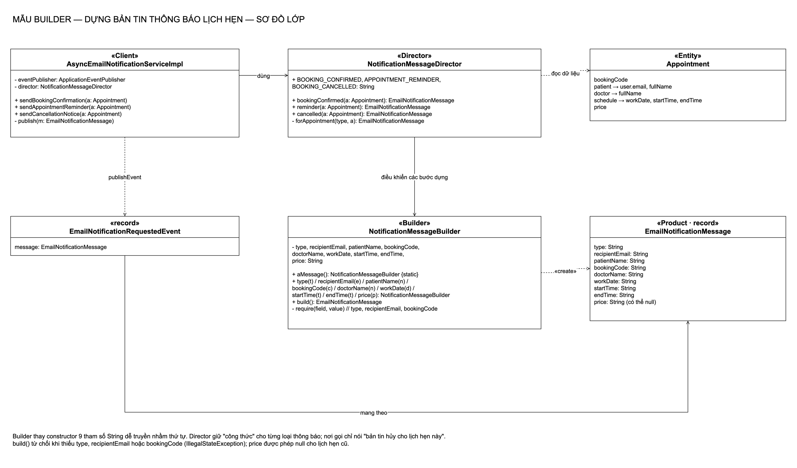
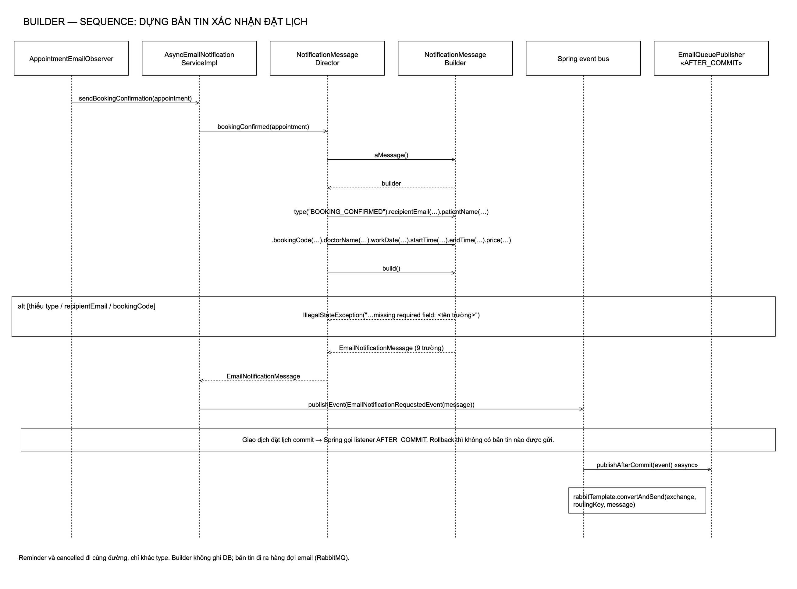
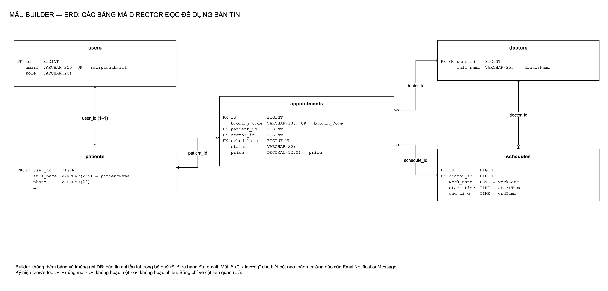
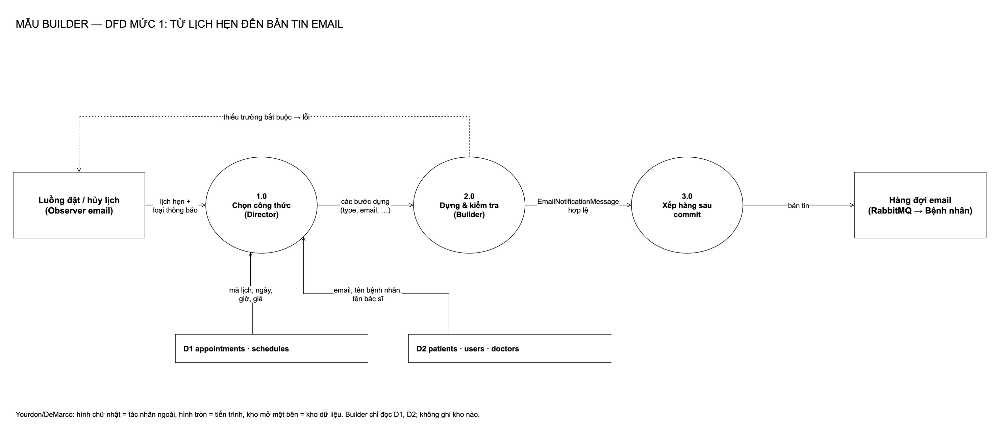
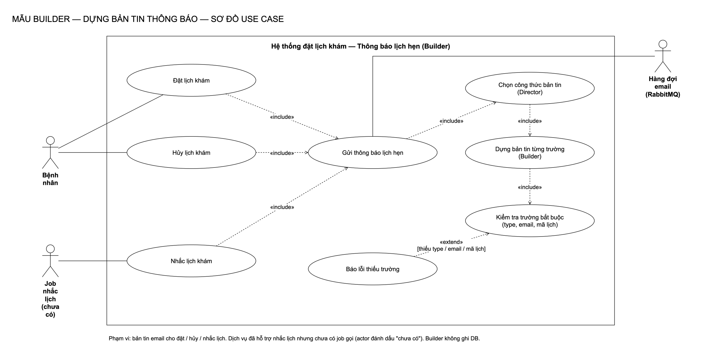

# Builder: dựng bản tin thông báo lịch hẹn

[← Bản đồ 7 mẫu](../README.md) · [Kịch bản thuyết trình](kich-ban-thuyet-trinh.md)

## 1. Mẫu Builder là gì

Builder là mẫu **khởi tạo (creational)** trong GoF: *tách việc dựng một đối tượng phức tạp khỏi cách biểu diễn nó, để cùng một quy trình dựng có thể tạo ra các biểu diễn khác nhau.*

| Thành phần | Vai trò |
|---|---|
| **Builder** | Cung cấp từng bước dựng có tên rõ ràng và bước `build()` cuối cùng |
| **Director** | Biết "công thức": gọi các bước theo thứ tự cho từng loại sản phẩm |
| **Product** | Đối tượng hoàn chỉnh được dựng ra |
| **Client** | Nhờ Director (hoặc trực tiếp Builder) để có sản phẩm |

Ví dụ ngoài đời: quầy bánh mì. Nhân viên (Director) thuộc công thức "bánh mì thịt", "bánh mì trứng"; quầy nguyên liệu (Builder) cho phép thêm từng thứ; ổ bánh hoàn chỉnh là Product.

## 2. Bài toán trong hệ thống

**Trước:** mỗi email (xác nhận, nhắc lịch, hủy) được tạo bằng `new EmailNotificationMessage(type, email, patientName, bookingCode, doctorName, workDate, startTime, endTime, price)`: 9 tham số đều là `String`.

- Đổi chỗ `startTime` và `endTime`, hay `patientName` và `doctorName`, trình biên dịch không phát hiện.
- Thiếu email người nhận hay mã lịch hẹn chỉ lộ ra khi worker gửi mail thất bại.
- Ba loại thông báo lặp cùng một đoạn lấy dữ liệu từ `Appointment`.

**Phương án đã cân nhắc:**

| Phương án | Vì sao không chọn |
|---|---|
| Giữ constructor, thêm comment | Không ngăn được truyền nhầm |
| Lombok `@Builder` | Có builder nhưng không có chỗ kiểm tra trường bắt buộc và không có Director; khó trình bày mẫu |
| Factory method cho từng loại | Vẫn phải gọi constructor 9 tham số bên trong |
| **Builder viết tay + Director** | Đặt tên từng bước, kiểm tra lúc `build()`, công thức nằm một chỗ |

## 3. Thiết kế

| Vai trò | Lớp | Ghi chú |
|---|---|---|
| Builder | [`NotificationMessageBuilder`](../../backend/src/main/java/com/datlichkhambenh/backend/builder/NotificationMessageBuilder.java) | `aMessage()`, 9 hàm theo tên trường, `build()` kiểm tra `type`, `recipientEmail`, `bookingCode` |
| Director | [`NotificationMessageDirector`](../../backend/src/main/java/com/datlichkhambenh/backend/builder/NotificationMessageDirector.java) | `bookingConfirmed`, `reminder`, `cancelled` |
| Product | [`EmailNotificationMessage`](../../backend/src/main/java/com/datlichkhambenh/backend/messaging/EmailNotificationMessage.java) | record 9 trường, không đổi hình dạng (worker email không phải sửa) |
| Client | [`AsyncEmailNotificationServiceImpl`](../../backend/src/main/java/com/datlichkhambenh/backend/service/impl/AsyncEmailNotificationServiceImpl.java) | Chỉ gọi Director rồi phát `EmailNotificationRequestedEvent` |

## 4. Sơ đồ

| Class | Sequence |
|---|---|
|  |  |

| ERD | DFD |
|---|---|
|  |  |

**Use case**

Nguồn `.drawio` trong [diagrams/](diagrams/), sinh bằng `python3 scripts/builder/generate-diagrams.py`.

## 5. Quyết định thiết kế

1. **Kiểm tra trong `build()` chứ không ở từng setter.** Builder cho phép đặt trường theo thứ tự bất kỳ; chỉ lúc kết thúc mới biết thiếu gì. Lỗi là `IllegalStateException` nêu tên trường.
2. **`price` được phép null.** Lịch hẹn tạo trước khi có tính phí Strategy không có giá; từ chối sẽ làm hỏng email của dữ liệu cũ.
3. **Director là bean Spring.** Dễ tiêm vào dịch vụ email và vào Decorator SMS (dùng chung công thức cho nội dung SMS).
4. **Không đổi `EmailNotificationMessage`.** Hàng đợi và worker email nhận đúng bản tin như cũ, nên refactor không lan ra ngoài.

## 6. Kiểm thử

| Test | Chứng minh |
|---|---|
| [`NotificationMessageIntegrationTests`](../../backend/src/test/java/com/datlichkhambenh/backend/builder/NotificationMessageIntegrationTests.java) | Qua API: đặt lịch → bản tin ở RabbitTemplate đủ 9 trường đúng giá trị; hủy → bản tin loại hủy |
| [`NotificationMessageBuilderTests`](../../backend/src/test/java/com/datlichkhambenh/backend/builder/NotificationMessageBuilderTests.java) | Thiếu từng trường bắt buộc → lỗi nêu tên trường; thiếu giá → vẫn dựng được |
| [`NotificationMessageDirectorTests`](../../backend/src/test/java/com/datlichkhambenh/backend/builder/NotificationMessageDirectorTests.java) | Mỗi công thức ra đúng loại; nhắc lịch mang đúng ngày giờ |

## 7. Hạn chế

- Builder có 9 hàm gần như trùng tên trường: nhiều dòng code cho một record nhỏ.
- Kiểm tra mới ở mức "có/không", chưa kiểm tra định dạng email hay ngày giờ.
- Builder không thread-safe (mỗi lần dựng tạo builder mới qua `aMessage()`, nên trong thực tế không phải vấn đề).
