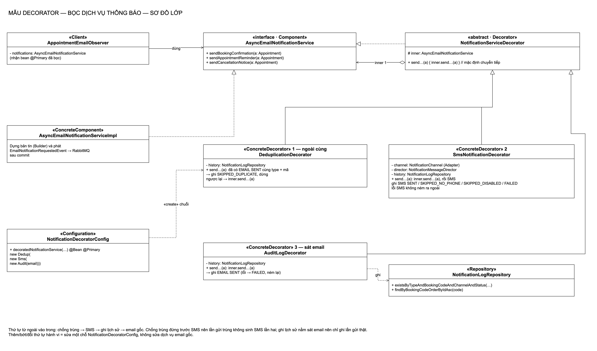
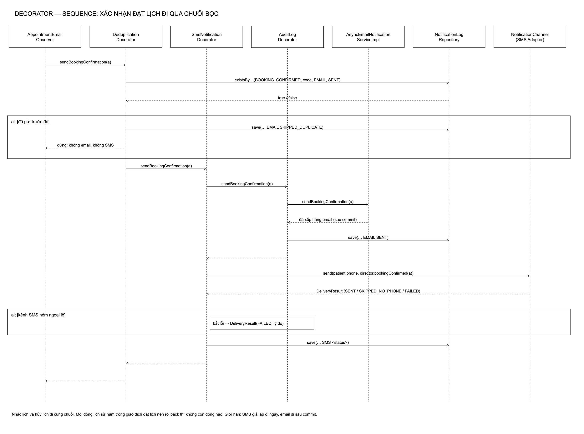
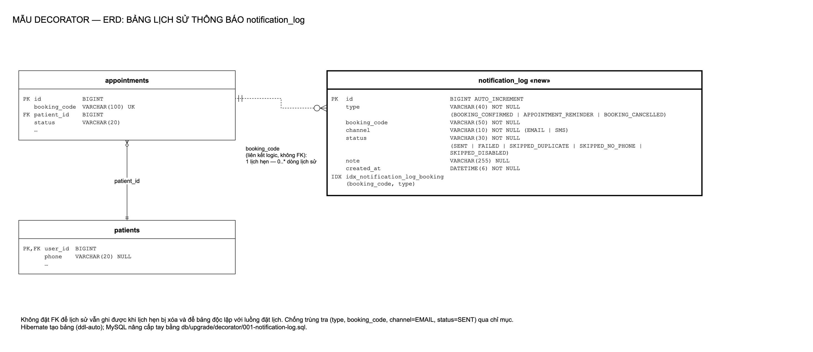
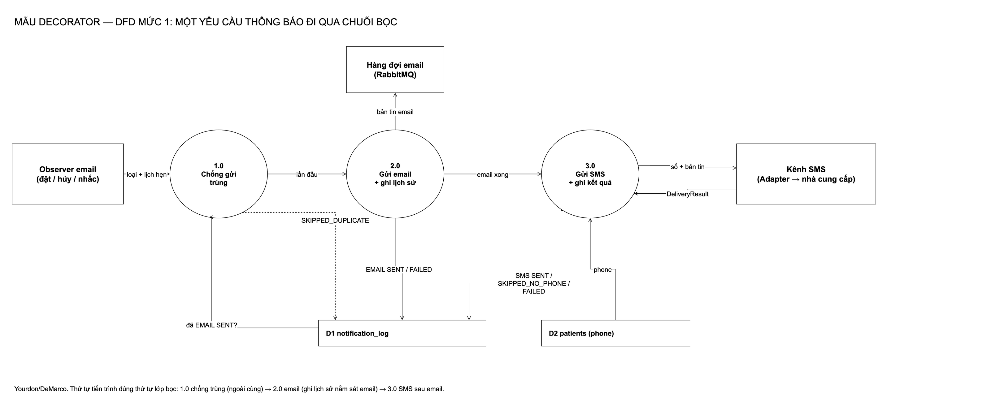

# Decorator: bọc dịch vụ thông báo

[← Bản đồ 7 mẫu](../README.md) · [Kịch bản thuyết trình](kich-ban-thuyet-trinh.md)

## 1. Mẫu Decorator là gì

Decorator là mẫu **cấu trúc (structural)** trong GoF: *gắn thêm trách nhiệm cho một đối tượng một cách động; là cách mở rộng chức năng linh hoạt thay cho kế thừa.*

| Thành phần | Vai trò |
|---|---|
| **Component** | Giao diện chung |
| **ConcreteComponent** | Đối tượng gốc |
| **Decorator** | Cùng giao diện, giữ tham chiếu tới Component bên trong, mặc định chuyển tiếp |
| **ConcreteDecorator** | Thêm hành vi trước/sau khi chuyển tiếp |

Ví dụ ngoài đời: ly cà phê. Cà phê đen là gốc; thêm sữa, thêm đường, thêm kem là các lớp bọc. Món nào cũng vẫn là "một ly cà phê", và có thể chồng lớp theo bất kỳ tổ hợp nào.

## 2. Bài toán trong hệ thống

Dịch vụ thông báo chỉ biết gửi email. Phòng khám cần thêm:

- **lịch sử thông báo** để tra cứu khi bệnh nhân nói không nhận được;
- **chống gửi trùng** (cùng loại, cùng lịch hẹn) khi nhắc lịch bị gọi hai lần;
- **gửi thêm SMS** qua kênh Adapter.

**Phương án đã cân nhắc:**

| Phương án | Vì sao không chọn |
|---|---|
| Sửa thẳng `AsyncEmailNotificationServiceImpl` | Một lớp ôm email, SMS, lịch sử, chống trùng; mỗi hành vi mới là một lần sửa |
| Kế thừa (EmailWithLog, EmailWithLogAndSms…) | Bùng nổ số lớp theo tổ hợp; không đổi thứ tự được |
| Thêm observer cho từng hành vi | Observer không chặn được lần gửi trùng; thứ tự không đảm bảo |
| **Decorator** | Mỗi hành vi một lớp nhỏ, cùng giao diện, xếp chồng ở một chỗ cấu hình |

## 3. Thiết kế

Thứ tự từ ngoài vào trong: **chống trùng → SMS → ghi lịch sử → email gốc**.

| Vai trò | Lớp | Ghi chú |
|---|---|---|
| Component | [`AsyncEmailNotificationService`](../../backend/src/main/java/com/datlichkhambenh/backend/service/AsyncEmailNotificationService.java) | `sendBookingConfirmation`, `sendAppointmentReminder`, `sendCancellationNotice` |
| ConcreteComponent | [`AsyncEmailNotificationServiceImpl`](../../backend/src/main/java/com/datlichkhambenh/backend/service/impl/AsyncEmailNotificationServiceImpl.java) | Dựng bản tin (Builder), xếp hàng email sau commit |
| Decorator | [`NotificationServiceDecorator`](../../backend/src/main/java/com/datlichkhambenh/backend/decorator/NotificationServiceDecorator.java) | abstract, giữ `inner`, mặc định chuyển tiếp |
| ConcreteDecorator 1 | [`DeduplicationDecorator`](../../backend/src/main/java/com/datlichkhambenh/backend/decorator/DeduplicationDecorator.java) | Đã có EMAIL SENT cùng loại + mã → ghi SKIPPED_DUPLICATE, dừng |
| ConcreteDecorator 2 | [`SmsNotificationDecorator`](../../backend/src/main/java/com/datlichkhambenh/backend/decorator/SmsNotificationDecorator.java) | Gọi bên trong trước, rồi SMS qua `NotificationChannel`; lỗi SMS chỉ ghi lại |
| ConcreteDecorator 3 | [`AuditLogDecorator`](../../backend/src/main/java/com/datlichkhambenh/backend/decorator/AuditLogDecorator.java) | Ghi EMAIL SENT (lỗi → FAILED rồi ném lại) |
| Lắp ráp | [`NotificationDecoratorConfig`](../../backend/src/main/java/com/datlichkhambenh/backend/decorator/NotificationDecoratorConfig.java) | Bean `@Primary` duy nhất; mọi nơi tiêm dịch vụ thông báo nhận bản đã bọc |
| Lưu trữ | [`NotificationLog`](../../backend/src/main/java/com/datlichkhambenh/backend/decorator/NotificationLog.java), [`NotificationLogRepository`](../../backend/src/main/java/com/datlichkhambenh/backend/decorator/NotificationLogRepository.java) | Bảng `notification_log`; MySQL nâng cấp tay: [001-notification-log.sql](../../backend/src/main/resources/db/upgrade/decorator/001-notification-log.sql) |

## 4. Sơ đồ

| Class | Sequence |
|---|---|
|  |  |

| ERD | DFD |
|---|---|
|  |  |

Nguồn `.drawio` trong [diagrams/](diagrams/), sinh bằng `python3 scripts/decorator/generate-diagrams.py`.

## 5. Quyết định thiết kế

1. **Thứ tự chống trùng → SMS → ghi lịch sử → email** (đổi so với spec ban đầu "ghi lịch sử ngoài cùng"). Nếu ghi lịch sử ở ngoài cùng, nó không biết lớp trong đã bỏ qua do trùng và sẽ ghi SENT sai. Đặt sát email thì nó chỉ ghi lần gửi thật. Chống trùng đứng trước SMS nên lần gửi trùng không sinh SMS thứ hai.
2. **Chống trùng đọc bảng, không đọc bộ nhớ.** Restart server vẫn không gửi lại.
3. **Lỗi SMS không lan ra.** SMS là kênh phụ; email và việc đặt lịch phải thành công dù nhà cung cấp SMS sập.
4. **Không đặt khóa ngoại** từ `notification_log` sang `appointments`; liên kết qua `booking_code` để lịch sử độc lập với vòng đời lịch hẹn.
5. **Lịch sử ghi trong giao dịch đặt lịch.** Rollback thì không còn dòng nào.

## 6. Kiểm thử

| Test | Chứng minh |
|---|---|
| [`NotificationDecoratorIntegrationTests`](../../backend/src/test/java/com/datlichkhambenh/backend/decorator/NotificationDecoratorIntegrationTests.java) | Qua API: đặt lịch → EMAIL SENT + SMS SKIPPED_NO_PHONE; nhắc lịch hai lần → 1 email, có dòng SKIPPED_DUPLICATE |
| [`SmsNotificationIntegrationTests`](../../backend/src/test/java/com/datlichkhambenh/backend/decorator/SmsNotificationIntegrationTests.java) | Có số → nhà cung cấp nhận 1 tin, SMS SENT; nhắc trùng → không có SMS thứ hai (khóa thứ tự chuỗi; đã thử đảo thứ tự, test đỏ) |
| [`SmsFailureIntegrationTests`](../../backend/src/test/java/com/datlichkhambenh/backend/decorator/SmsFailureIntegrationTests.java) | Nhà cung cấp luôn ném lỗi → đặt lịch 201, email vẫn đi, SMS FAILED |

## 7. Hạn chế

- **SMS đi trước commit, email đi sau commit.** Nếu giao dịch hỏng ở bước commit cuối, SMS đã gửi mà lịch không được lưu. Các nhánh từ chối đã kiểm thử đều xảy ra trước khi gửi. Cách sửa: dời SMS sang sau commit (TransactionSynchronization).
- "SENT" của email nghĩa là *đã đưa vào hàng đợi*, chưa phải bệnh nhân đã nhận.
- Chưa có màn hình Admin xem lịch sử (ngoài phạm vi spec).
- Chuỗi nhiều lớp bọc khó debug hơn một lớp duy nhất.
