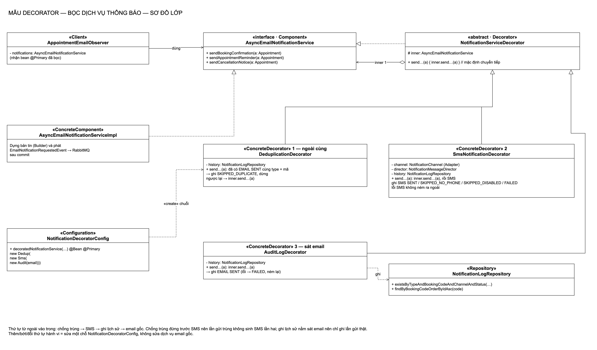
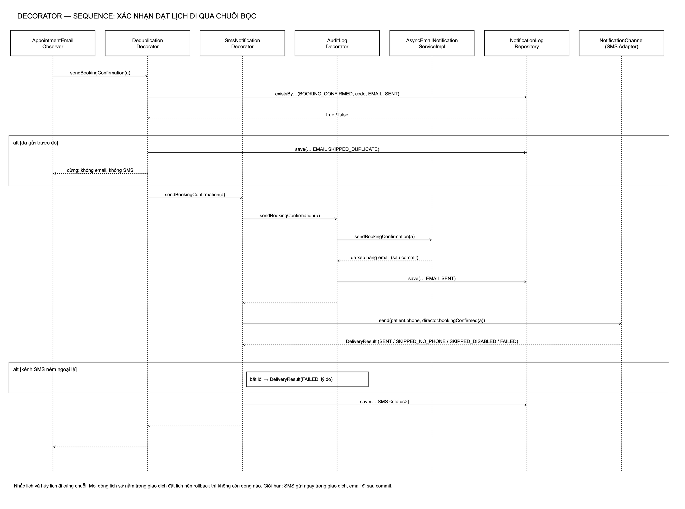
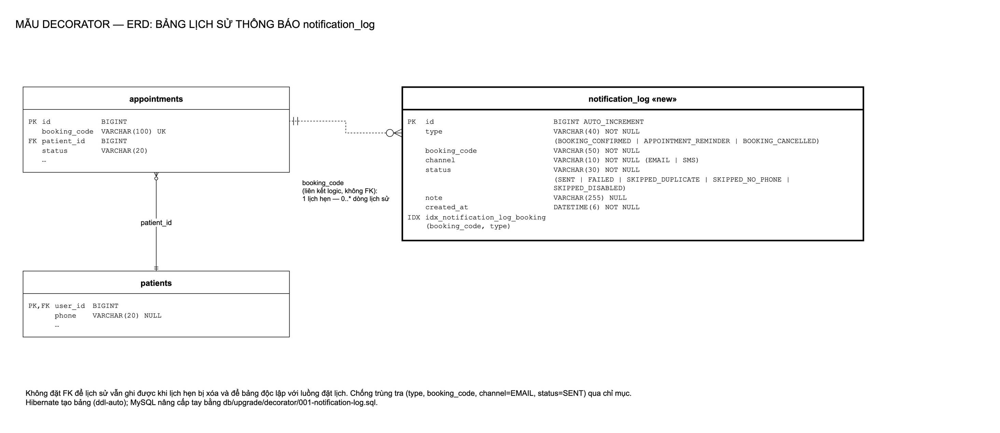
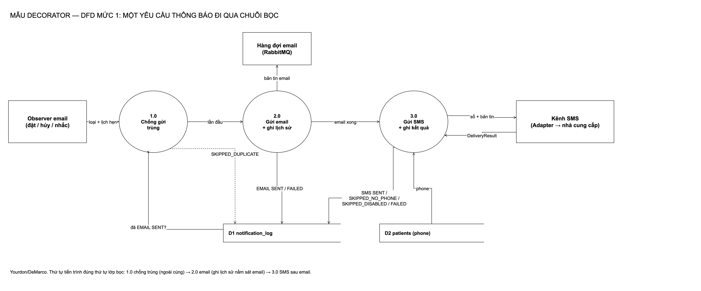
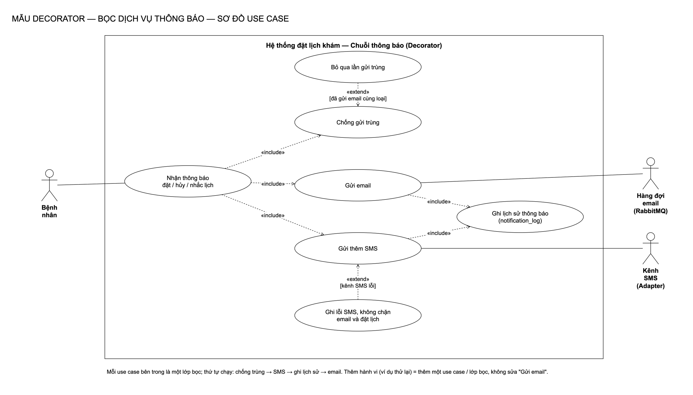
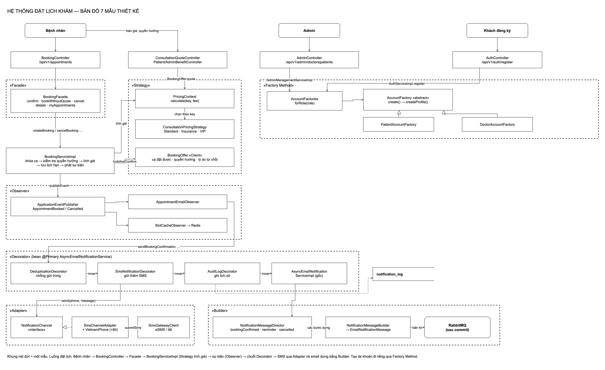

# Decorator: lý thuyết, điều kiện, cách làm trong bài và nếu không dùng thì sao

[← README Decorator](README.md) · [Tài liệu chi tiết](tai-lieu-decorator.md) · [Kịch bản thuyết trình chung](../thuyet-trinh-adapter-decorator.md) · [Lý thuyết Adapter](../adapter/ly-thuyet-adapter.md)

Tài liệu này để **học và trả lời vấn đáp**: đọc từ trên xuống là nói được mẫu Decorator từ lý thuyết tới code trong đồ án.

---

## 1. Lý thuyết

### 1.1 Định nghĩa

| Mục | Nội dung |
|---|---|
| Tên | **Decorator** (tên khác: **Wrapper**) |
| Nhóm | Mẫu **cấu trúc** (structural) trong 23 mẫu GoF (*Design Patterns*, 1994) |
| Ý định (intent) | *Gắn thêm trách nhiệm cho một đối tượng một cách động. Decorator là cách mở rộng chức năng linh hoạt thay cho việc tạo lớp con.* |
| Một câu dễ nhớ | **Giữ nguyên đối tượng gốc, bọc thêm từng lớp; mỗi lớp làm thêm một việc rồi chuyển tiếp vào trong.** |

### 1.2 Vấn đề gốc mà mẫu giải quyết

Ta có một đối tượng đang chạy tốt và muốn **thêm hành vi** cho nó (ghi log, kiểm tra, nén, mã hóa, gửi thêm…). Cách tự nhiên nhất là **kế thừa**, nhưng kế thừa có ba vấn đề:

1. **Bùng nổ số lớp**: với *n* hành vi tùy chọn, muốn mọi tổ hợp thì cần tới 2ⁿ lớp con. 3 hành vi → 8 lớp; 4 hành vi → 16 lớp.
2. **Tĩnh**: tổ hợp được chốt lúc biên dịch, không bật/tắt hay đổi thứ tự lúc chạy.
3. **Gắn chặt**: lớp con phụ thuộc vào chi tiết bên trong của lớp cha.

Cách thứ hai là **nhét hết vào một lớp**: lớp đó phình to, mỗi hành vi mới là một lần sửa lớp đang chạy.

Decorator giải quyết bằng **composition**: mỗi hành vi là một lớp nhỏ **cùng giao diện** với đối tượng gốc, **giữ** đối tượng bên trong và **chuyển tiếp** lời gọi. Các lớp bọc lồng vào nhau như búp bê Nga.

### 1.3 Bốn thành phần

| Thành phần | Vai trò |
|---|---|
| **Component** | Giao diện chung cho cả đối tượng gốc và lớp bọc |
| **ConcreteComponent** | Đối tượng gốc, làm việc chính |
| **Decorator** (trừu tượng) | Hiện thực Component, giữ một tham chiếu tới Component bên trong (`inner`), mặc định chuyển tiếp mọi lời gọi |
| **ConcreteDecorator** | Kế thừa Decorator, thêm hành vi **trước** và/hoặc **sau** khi chuyển tiếp, hoặc **quyết định không chuyển tiếp** |

**Cộng tác:** Client gọi lớp ngoài cùng → mỗi lớp làm phần của nó rồi gọi `inner` → cuối cùng tới đối tượng gốc → kết quả đi ngược ra.

```
Client ──► «interface» Component
                 ▲            ▲
   ConcreteComponent      Decorator (abstract) ──giữ──► Component (inner)
                               ▲
              ConcreteDecoratorA, ConcreteDecoratorB, …
```

### 1.4 Ba kiểu hành vi một lớp bọc có thể thêm

| Kiểu | Ví dụ |
|---|---|
| **Trước** khi chuyển tiếp | Kiểm tra quyền, kiểm tra trùng, chuẩn hóa đầu vào |
| **Sau** khi chuyển tiếp | Ghi log, gửi thêm kênh khác, đo thời gian |
| **Thay vì** chuyển tiếp (chặn) | Bỏ qua lần gửi trùng, trả kết quả từ cache |

### 1.5 Đặc điểm quan trọng

- **Trong suốt (transparent):** bản đã bọc có **cùng giao diện** với bản gốc, nơi dùng không biết có bao nhiêu lớp bọc.
- **Thứ tự có ý nghĩa:** bọc A ngoài B khác với bọc B ngoài A.
- **Đệ quy:** lớp bọc có thể bọc một lớp bọc khác, không giới hạn số tầng.
- **Danh tính khác nhau:** đối tượng đã bọc **không phải** là đối tượng gốc (`==` khác nhau), nên đừng viết code dựa trên danh tính.

---

## 2. Công dụng

1. **Thêm hành vi mà không sửa lớp gốc** (lớp gốc đã chạy ổn, đã kiểm thử).
2. **Tránh bùng nổ lớp con** khi có nhiều hành vi tùy chọn.
3. **Bật/tắt, đổi thứ tự** hành vi ở một chỗ cấu hình.
4. **Tách các mối quan tâm cắt ngang** (log, kiểm tra, thống kê) ra khỏi nghiệp vụ chính.
5. **Kiểm thử riêng** từng hành vi.

### Ví dụ ngoài đời

| Ví dụ | Gốc | Các lớp bọc |
|---|---|---|
| Ly cà phê | Cà phê đen | Sữa, đường, kem; món nào cũng vẫn là "một ly cà phê" |
| Gửi bưu phẩm | Gói hàng | Bọc chống sốc, bảo hiểm, giao nhanh, báo tin nhắn |
| Mặc quần áo | Người | Áo sơ mi, áo len, áo khoác: thêm lớp, bỏ lớp tùy thời tiết |
| Khung ảnh | Bức ảnh | Viền, kính, khung gỗ |

### Ví dụ trong Java / Spring

| Ví dụ | Gốc | Lớp bọc |
|---|---|---|
| `java.io` | `FileInputStream` | `BufferedInputStream`, `GZIPInputStream`, `DataInputStream` |
| Collections | `ArrayList` | `Collections.unmodifiableList`, `Collections.synchronizedList` |
| Servlet | `HttpServletRequest` | `HttpServletRequestWrapper` |
| Spring | `DataSource` | `TransactionAwareDataSourceProxy`, `LazyConnectionDataSourceProxy` |

Ví dụ kinh điển nhất: `new BufferedReader(new InputStreamReader(new FileInputStream("a.txt")))` (đọc file → đổi byte thành ký tự (Adapter) → thêm bộ đệm (Decorator)).

---

## 3. Điều kiện áp dụng

### 3.1 Theo GoF, dùng Decorator khi

1. Muốn thêm trách nhiệm cho **từng đối tượng** một cách **động và trong suốt**, không ảnh hưởng đối tượng khác.
2. Trách nhiệm đó **có thể gỡ bỏ** được.
3. Mở rộng bằng **lớp con không thực tế**: quá nhiều tổ hợp, hoặc lớp gốc bị ẩn / `final`.

### 3.2 Dấu hiệu nhận biết trong code (nên dùng Decorator)

- Một lớp có nhiều đoạn `if (bậtTínhNăngX)` bao quanh việc chính.
- Muốn thêm log / kiểm tra / gửi thêm, và cách duy nhất đang nghĩ tới là sửa lớp đang chạy.
- Có tên lớp kiểu `EmailWithLogAndSmsService`.
- Các hành vi phụ phải chạy **theo thứ tự** và có thể **chặn** việc chính.

### 3.3 Không nên dùng khi

- Chỉ có **một** hành vi thêm và không bao giờ đổi.
- Giao diện Component **quá lớn**: mỗi lớp bọc phải chuyển tiếp hàng chục hàm.
- Hành vi phụ **không liên quan** tới việc chính mà chỉ là "phản ứng sau khi chuyện xảy ra" → Observer hợp hơn.
- Code dựa vào **danh tính** đối tượng (`==`, `instanceof` lớp gốc).

### 3.4 Điều kiện để Decorator của đồ án đúng mẫu

| Điều kiện | Trong đồ án |
|---|---|
| Có Component chung | `AsyncEmailNotificationService` (3 hàm gửi) |
| Có ConcreteComponent không bị sửa | `AsyncEmailNotificationServiceImpl`: **không đổi một dòng** từ trước khi có Decorator tới nay |
| Decorator cùng giao diện, giữ `inner`, mặc định chuyển tiếp | `NotificationServiceDecorator implements AsyncEmailNotificationService` |
| Nơi dùng không biết có lớp bọc | Observer email chỉ tiêm `AsyncEmailNotificationService`, nhận bean `@Primary` đã bọc |

---

## 4. Ưu điểm và nhược điểm (hệ quả của mẫu)

| Ưu điểm | Nhược điểm |
|---|---|
| Linh hoạt hơn kế thừa: thêm, bỏ, đổi thứ tự ở một chỗ | Nhiều đối tượng nhỏ, khó lần theo khi debug |
| Không có lớp "ôm đủ thứ" ở trên cùng của cây kế thừa | Thứ tự sai thì hành vi sai, và trình biên dịch không phát hiện |
| Mỗi hành vi một lớp, kiểm thử riêng | Mỗi hàm mới của Component phải thêm vào lớp Decorator trừu tượng |
| Lớp gốc giữ nguyên | Đối tượng đã bọc khác danh tính với đối tượng gốc |

---

## 5. Cách cài đặt chung (các bước)

1. **Xác định Component**: giao diện mà nơi dùng đang gọi.
2. **Giữ nguyên ConcreteComponent**.
3. **Viết lớp Decorator trừu tượng**: hiện thực Component, nhận `inner` qua constructor, mọi hàm mặc định gọi `inner`.
4. **Viết mỗi hành vi thành một ConcreteDecorator**, chỉ ghi đè phần cần thêm.
5. **Lắp ráp ở một chỗ** (factory, cấu hình Spring), quyết định thứ tự.
6. **Cho nơi dùng nhận bản đã bọc** mà không biết (trong Spring: `@Primary`).
7. **Kiểm thử thứ tự**: viết test sẽ đỏ nếu đảo thứ tự.

---

## 6. Cách làm trong bài

### 6.1 Bài toán

Dịch vụ thông báo chỉ biết dựng bản tin và xếp email vào hàng đợi. Phòng khám cần thêm:

| Hành vi | Lý do |
|---|---|
| **Chống gửi trùng** | Nhắc lịch bị gọi hai lần → bệnh nhân nhận hai email, hai SMS |
| **Gửi thêm SMS** | Nhiều bệnh nhân không đọc email |
| **Ghi lịch sử thông báo** | Bệnh nhân nói "không nhận được email", phòng khám cần tra cứu |

### 6.2 Ánh xạ vai trò

| Vai trò GoF | Lớp trong đồ án |
|---|---|
| Component | `service/AsyncEmailNotificationService` |
| ConcreteComponent | `service/impl/AsyncEmailNotificationServiceImpl` |
| Decorator | `decorator/NotificationServiceDecorator` (abstract, giữ `inner`) |
| ConcreteDecorator | `DeduplicationDecorator`, `SmsNotificationDecorator`, `AuditLogDecorator` |
| Lắp ráp | `decorator/NotificationDecoratorConfig` (bean `@Primary`) |
| Client | `observer/AppointmentEmailObserver` |
| Lưu trữ | `NotificationLog`, bảng `notification_log` |

### 6.3 Lớp Decorator trừu tượng

```java
public abstract class NotificationServiceDecorator implements AsyncEmailNotificationService {
    protected final AsyncEmailNotificationService inner;
    protected NotificationServiceDecorator(AsyncEmailNotificationService inner) { this.inner = inner; }
    public void sendBookingConfirmation(Appointment a) { inner.sendBookingConfirmation(a); }
    public void sendAppointmentReminder(Appointment a) { inner.sendAppointmentReminder(a); }
    public void sendCancellationNotice(Appointment a)  { inner.sendCancellationNotice(a); }
}
```

### 6.4 Ba lớp bọc, ba kiểu hành vi

| Lớp | Kiểu | Làm gì |
|---|---|---|
| `DeduplicationDecorator` | **Chặn** (thay vì chuyển tiếp) | Đã có `EMAIL SENT` cùng loại + cùng mã lịch → ghi `SKIPPED_DUPLICATE`, **không** gọi `inner` |
| `SmsNotificationDecorator` | **Sau** | Gọi `inner` trước (email), rồi gửi SMS qua `NotificationChannel` (Adapter); lỗi SMS chỉ ghi `SMS FAILED` |
| `AuditLogDecorator` | **Sau** (và khi lỗi) | Gọi `inner`; thành công ghi `EMAIL SENT`, lỗi ghi `EMAIL FAILED` rồi ném lại |

### 6.5 Lắp ráp và thứ tự

```java
@Bean @Primary
public AsyncEmailNotificationService decoratedNotificationService(...) {
    // Từ ngoài vào trong: chống trùng → SMS → ghi lịch sử → email gốc
    return new DeduplicationDecorator(
            new SmsNotificationDecorator(
                    new AuditLogDecorator(email, history),
                    sms, director, history),
            history);
}
```

**Vì sao thứ tự này:**

| Nếu đặt… | Hậu quả | Nên… |
|---|---|---|
| Ghi lịch sử **ngoài cùng** (spec ban đầu) | Lần gửi bị chặn vì trùng vẫn bị ghi `SENT` | Đặt ghi lịch sử sát email: chỉ ghi lần gửi thật |
| SMS **ngoài** chống trùng | Lần gửi trùng vẫn sinh SMS thứ hai | Đặt chống trùng ngoài cùng |
| Chống trùng **trong** cùng | Email bị chặn nhưng SMS đã đi | Như trên |

Nhóm đã thử đảo thứ tự, test `duplicateReminderSendsNoSecondSms` đỏ ngay.

### 6.6 Luồng chạy một lần đặt lịch

1. `BookingServiceImpl` lưu lịch, phát `AppointmentBookedEvent` (Observer).
2. `AppointmentEmailObserver` gọi `sendBookingConfirmation` trên bean `@Primary`.
3. `DeduplicationDecorator`: tra `notification_log`, chưa gửi → chuyển tiếp.
4. `SmsNotificationDecorator`: chuyển tiếp vào trong trước.
5. `AuditLogDecorator`: chuyển tiếp vào email gốc.
6. `AsyncEmailNotificationServiceImpl`: Director (Builder) dựng bản tin, phát sự kiện; email chỉ vào RabbitMQ **sau commit**.
7. `AuditLogDecorator` ghi `EMAIL SENT`.
8. `SmsNotificationDecorator` gửi SMS qua Adapter, ghi `SMS SENT / SKIPPED_NO_PHONE / SKIPPED_DISABLED / FAILED`.

### 6.7 Bảng `notification_log`

| Cột | Ý nghĩa |
|---|---|
| `type` | Loại tin: `BOOKING_CONFIRMED`, `APPOINTMENT_REMINDER`, `BOOKING_CANCELLED` |
| `booking_code` | Mã lịch hẹn (không khóa ngoại) |
| `channel` | `EMAIL` / `SMS` |
| `status` | `SENT`, `FAILED`, `SKIPPED_DUPLICATE`, `SKIPPED_NO_PHONE`, `SKIPPED_DISABLED` |
| `note` | Lý do, cắt còn 255 ký tự |
| `created_at` | Thời điểm |

### 6.8 Đã kiểm chứng

5 test tích hợp qua API pass (chạy lại ngày 13/11/2026): `NotificationDecoratorIntegrationTests` 2, `SmsNotificationIntegrationTests` 2, `SmsFailureIntegrationTests` 1.

---

## 7. Nếu không dùng Decorator thì sao

Có ba cách "không dùng Decorator". Cả ba đều tệ hơn.

### 7.1 Cách A: nhét hết vào lớp email gốc (minh họa, không có trong đồ án)

```java
// MINH HỌA "KHÔNG DÙNG DECORATOR": một lớp ôm 4 trách nhiệm, lặp ở cả 3 hàm
public void sendAppointmentReminder(Appointment a) {
    if (history.existsByTypeAndBookingCodeAndChannelAndStatus("APPOINTMENT_REMINDER", a.getBookingCode(), "EMAIL", "SENT")) {
        history.save(new NotificationLog(..., "SKIPPED_DUPLICATE", ...));
        return;
    }
    try {
        publish(director.reminder(a));
        history.save(new NotificationLog(..., "EMAIL", "SENT", null));
    } catch (RuntimeException e) {
        history.save(new NotificationLog(..., "EMAIL", "FAILED", e.getMessage()));
        throw e;
    }
    if (smsEnabled) {
        try { /* gửi SMS */ } catch (RuntimeException e) { /* ghi SMS FAILED */ }
    }
}
// …và chép lại gần y hệt cho sendBookingConfirmation, sendCancellationNotice
```

| Hậu quả | Cụ thể |
|---|---|
| **Lặp code ×3** | Ba hàm gửi đều chứa cùng khối chống trùng, ghi lịch sử, gửi SMS |
| **Sửa lớp đang chạy** | Lớp email đã ổn định với hàng đợi sau commit; mỗi hành vi mới là một lần đụng vào nó |
| **Khó đọc thứ tự** | Thứ tự nằm rải trong thân hàm, ba hàm có thể lệch nhau |
| **Khó kiểm thử riêng** | Không test được "chống trùng" mà không kéo theo email và SMS |
| **Vi phạm SRP, OCP** | Một lớp, bốn lý do để sửa |

### 7.2 Cách B: kế thừa cho từng tổ hợp

| Tổ hợp | Lớp con cần có |
|---|---|
| Email | `EmailService` |
| + lịch sử | `EmailWithLog` |
| + SMS | `EmailWithSms` |
| + chống trùng | `EmailWithDedup` |
| + lịch sử + SMS | `EmailWithLogAndSms` |
| + lịch sử + chống trùng | `EmailWithLogAndDedup` |
| + SMS + chống trùng | `EmailWithSmsAndDedup` |
| + cả ba | `EmailWithLogAndSmsAndDedup` |

**8 lớp** cho 3 hành vi (2³). Thêm "thử lại khi lỗi" là **16 lớp**. Thứ tự bị chốt cứng trong cây kế thừa, không đổi được.

### 7.3 Cách C: gọi thẳng trong dịch vụ đặt lịch hoặc trong observer

- Dịch vụ đặt lịch (đang giữ **khóa bi quan** chống đặt trùng ca) phải biết thêm SMS, lịch sử, chống trùng → mỗi lần thêm hành vi là đụng vào chỗ nhạy cảm nhất hệ thống.
- Nếu tách thành nhiều observer: observer **không chặn được** lần gửi trùng (mọi observer đều chạy), và thứ tự giữa các observer **không đảm bảo**.

### 7.4 Chuyện gì sẽ xảy ra với người dùng

| # | Tình huống | Không có Decorator (làm sai / thiếu) | Có Decorator (đồ án) |
|---|---|---|---|
| 1 | Job nhắc lịch chạy hai lần | Bệnh nhân nhận **2 email + 2 SMS**, tốn phí SMS gấp đôi | 1 email, 1 SMS, có dòng `SKIPPED_DUPLICATE` |
| 2 | Bệnh nhân khiếu nại "không nhận được email" | Không có dữ liệu để trả lời | Tra `notification_log` theo mã lịch: đã xếp hàng lúc nào, SMS ra sao |
| 3 | Nhà cung cấp SMS sập | Nếu SMS nằm chung khối với email mà không cô lập lỗi: **đặt lịch lỗi 500** | Đặt lịch vẫn 201, email vẫn đi, ghi `SMS FAILED` |
| 4 | Khởi động lại server giữa hai lần nhắc | Chống trùng bằng bộ nhớ quên hết, gửi lại | Chống trùng tra bảng, vẫn đúng |
| 5 | Muốn tắt SMS tạm thời / đổi thứ tự | Sửa nhiều chỗ, chép lại logic | Sửa một chỗ: `NotificationDecoratorConfig` |
| 6 | Thêm hành vi "thử lại email" | Sửa lớp gốc hoặc nhân đôi số lớp con | Thêm một lớp bọc, chèn vào cấu hình |

### 7.5 Vi phạm nguyên tắc nào

| Nguyên tắc | Bị vi phạm thế nào khi không dùng Decorator |
|---|---|
| **SRP** | Lớp email ôm cả chống trùng, SMS, lịch sử |
| **OCP** | Thêm hành vi phải sửa lớp đang chạy (cách A) hoặc nhân đôi lớp (cách B) |
| **DRY** | Ba hàm gửi chép cùng một khối logic |
| **LSP / DIP** | Nơi dùng phải biết đang dùng lớp con tổ hợp nào (cách B) |

---

## 8. So sánh với các mẫu dễ nhầm

| Mẫu | Giống Decorator ở | Khác ở |
|---|---|---|
| **Adapter** | Cũng bọc một đối tượng | Adapter **đổi** giao diện; Decorator **giữ nguyên** và thêm hành vi |
| **Proxy** | Cùng giao diện, đứng trước đối tượng | Proxy **kiểm soát truy cập** (lười tải, phân quyền, từ xa), thường chỉ một tầng; Decorator **thêm hành vi**, chồng nhiều tầng |
| **Composite** | Cũng có cấu trúc đệ quy | Composite gom **nhiều con** thành cây; Decorator chỉ có **một** `inner` |
| **Strategy** | Cũng thay đổi hành vi | Strategy đổi **ruột** (thuật toán bên trong); Decorator đổi **vỏ** (thêm lớp bên ngoài) |
| **Chain of Responsibility** | Cũng là chuỗi đối tượng chuyển tiếp | Trong Chain thường **một** mắt xích xử lý rồi dừng; trong Decorator **mọi** lớp đều làm phần của mình |
| **Observer** | Cũng thêm phản ứng mà không sửa nơi phát | Observer **không chặn** được việc chính và không có thứ tự; Decorator chặn được và có thứ tự rõ |
| **AOP `@Around`** | Cũng bọc lời gọi | AOP ẩn thứ tự trong annotation và proxy; Decorator thấy rõ ở một chỗ, kiểm thử được |

**Trong đồ án:** Observer quyết định *khi đặt/hủy lịch thì ai phản ứng*; Decorator quyết định *gửi thông báo thì thêm hành vi gì*. Lớp bọc SMS là **Client** của Adapter.

---

## 9. SOLID trong Decorator của đồ án

| Nguyên tắc | Biểu hiện |
|---|---|
| **S**RP | Mỗi lớp bọc một việc: chống trùng, SMS, lịch sử |
| **O**CP | Thêm hành vi = thêm lớp bọc; `AsyncEmailNotificationServiceImpl` không đổi một dòng |
| **L**SP | Bản đã bọc thay bản gốc ở mọi nơi (observer không biết) |
| **I**SP | Component chỉ có 3 hàm gửi |
| **D**IP | Observer phụ thuộc `AsyncEmailNotificationService`, lớp bọc SMS phụ thuộc `NotificationChannel` |

---

## 10. Câu hỏi vấn đáp khó

| Câu hỏi | Trả lời |
|---|---|
| Lấy gì chứng minh "không sửa lớp gốc"? | `AsyncEmailNotificationServiceImpl` giống hệt trước commit thêm Decorator (`9131a96`): vẫn chỉ dựng bản tin và phát sự kiện. |
| Lớp bọc SMS vừa là Decorator vừa là Client của Adapter có sai không? | Không. Một lớp có thể đóng vai trong hai mẫu. Với Decorator nó là ConcreteDecorator; với Adapter nó là Client chỉ biết `NotificationChannel`. |
| Sao chống trùng chỉ xét `EMAIL SENT`? | Email là kênh chính. Đã có email thành công cùng loại cho cùng lịch thì lần sau là trùng, kể cả khi SMS lần trước lỗi. |
| Lịch sử ghi trong giao dịch có vấn đề gì? | Ưu: rollback thì không còn dòng giả. Nhược: SMS gửi ngay còn email gửi sau commit, nên commit hỏng ở bước cuối thì SMS đã đi; cách sửa là dời SMS sang sau commit. |
| Sao không đặt khóa ngoại `booking_code`? | Để lịch sử không phụ thuộc vòng đời lịch hẹn; xóa/đổi lịch không kéo theo lịch sử. |
| Decorator có làm chậm hệ thống? | Thêm một truy vấn kiểm tra trùng (có chỉ mục `booking_code, type`) và vài lệnh ghi lịch sử mỗi lần gửi; không đáng kể so với việc đặt lịch. |
| Thêm "chỉ gửi SMS giờ hành chính" thì sao? | Thêm một lớp bọc kiểm tra giờ, đặt ngoài lớp SMS. |

---

## 11. Giải thích sơ đồ

Năm sơ đồ nằm trong `docs/decorator/diagrams/`, sinh bằng `python3 scripts/decorator/generate-diagrams.py`.

### 11.1 Sơ đồ lớp (Class diagram)



**Mục đích:** cho thấy **cấu trúc bọc**: ai là gốc, ai là lớp bọc, lớp bọc giữ cái gì, và ai lắp chúng lại.

**Cách đọc ký hiệu:**

| Ký hiệu | Ý nghĩa |
|---|---|
| Nét đứt, tam giác rỗng | **Hiện thực** interface |
| Nét liền, tam giác rỗng | **Kế thừa** lớp (extends) |
| Nét liền, kim cương rỗng, chữ "inner 1" | **Aggregation**: lớp bọc giữ đúng **một** Component bên trong |
| Nét liền, mũi tên mở, "dùng" | Phụ thuộc / sử dụng |
| Nét đứt, «create» / "ghi" | Tạo đối tượng / ghi dữ liệu |
| `#` | protected |

**Đọc từng phần:**

1. **`AsyncEmailNotificationService` «interface · Component»** (trên giữa): 3 hàm `sendBookingConfirmation`, `sendAppointmentReminder`, `sendCancellationNotice`. Đây là **giao diện chung** mà cả gốc lẫn lớp bọc đều có.
2. **`AppointmentEmailObserver` «Client»** (trên trái): mũi tên "dùng" chỉ vào **Component**, ghi chú "nhận bean @Primary đã bọc". Client không biết có lớp bọc.
3. **`AsyncEmailNotificationServiceImpl` «ConcreteComponent»** (trái giữa): nét đứt tam giác rỗng đi lên Component, tức là hiện thực Component. Việc của nó: dựng bản tin (Builder), phát sự kiện, RabbitMQ gửi sau commit. **Lớp này không bị sửa.**
4. **`NotificationServiceDecorator` «abstract · Decorator»** (trên phải). Hai đường nối quan trọng nhất của mẫu:
   - nét đứt tam giác rỗng sang Component: lớp bọc **cũng là** một Component (cùng giao diện);
   - kim cương rỗng "inner 1" sang Component: lớp bọc **giữ** một Component bên trong (`# inner`), mặc định `send…(a) { inner.send…(a) }`.
   Hai đường này cùng nhau tạo nên Decorator: **"là một" và "có một"** cùng kiểu.
5. **Ba `«ConcreteDecorator»`** kế thừa lớp trừu tượng (nét liền tam giác rỗng):
   - **1 — ngoài cùng `DeduplicationDecorator`**: giữ `history`; đã có `EMAIL SENT` cùng type + mã → ghi `SKIPPED_DUPLICATE`, **dừng**; ngược lại → `inner.send…(a)`;
   - **2 — `SmsNotificationDecorator`**: giữ `channel: NotificationChannel (Adapter)`, `director`, `history`; gọi `inner.send…(a)` **rồi** gửi SMS; ghi `SMS SENT / SKIPPED_NO_PHONE / SKIPPED_DISABLED / FAILED`; lỗi SMS không ném ra ngoài;
   - **3 — sát email `AuditLogDecorator`**: gọi `inner.send…(a)` rồi ghi `EMAIL SENT` (lỗi → `FAILED`, ném lại).
6. **`NotificationDecoratorConfig` «Configuration»** (dưới trái): `@Bean @Primary`, `new Dedup(new Sms(new Audit(email)))`. Mũi tên «create» chuỗi: **nơi duy nhất** quyết định thứ tự.
7. **`NotificationLogRepository` «Repository»** (dưới phải): các lớp bọc "ghi" vào đây; có `existsByTypeAndBookingCodeAndChannelAndStatus(...)` cho chống trùng.

**Điểm cần nói:** "Chú ý hai đường từ lớp Decorator về Component: một đường 'là' (hiện thực) và một đường 'có' (inner). Nhờ vậy lớp bọc đứng được ở bất kỳ chỗ nào lớp gốc đứng. Thứ tự bọc nằm đúng một chỗ, hộp Configuration góc dưới."

### 11.2 Sơ đồ tuần tự (Sequence diagram)



**Mục đích:** cho thấy một lời gọi **đi xuyên qua các lớp bọc** theo đúng thứ tự, và các nhánh chặn / lỗi.

**Bảy đối tượng, trái sang phải:** `AppointmentEmailObserver` → `DeduplicationDecorator` → `SmsNotificationDecorator` → `AuditLogDecorator` → `AsyncEmailNotificationServiceImpl` → `NotificationLogRepository` → `NotificationChannel (SMS Adapter)`.

**Đọc từ trên xuống:**

1. Observer gọi `sendBookingConfirmation(a)` vào lớp **ngoài cùng** (chống trùng).
2. Chống trùng hỏi kho: `existsBy…(BOOKING_CONFIRMED, code, EMAIL, SENT)` → `true / false`.
3. **Khung `alt [đã gửi trước đó]`**: ghi `save(… EMAIL SKIPPED_DUPLICATE)` rồi **trả về ngay**, nhãn "dừng: không email, không SMS". Lời gọi **không đi sâu hơn**: đây là kiểu "chặn" của Decorator.
4. Nếu chưa gửi: chống trùng chuyển `sendBookingConfirmation(a)` vào **SMS decorator** → SMS decorator chuyển ngay vào **AuditLog** → AuditLog chuyển vào **email gốc**. Ba mũi tên đi xuống theo bậc thang: **chuỗi bọc lồng nhau**.
5. Email gốc trả "đã xếp hàng email (sau commit)".
6. AuditLog ghi `save(… EMAIL SENT)` rồi trả về SMS decorator.
7. **Sau khi email xong**, SMS decorator mới gọi `send(patient.phone, director.bookingConfirmed(a))` sang Adapter, nhận `DeliveryResult (SENT / SKIPPED_NO_PHONE / SKIPPED_DISABLED / FAILED)`.
8. **Khung `alt [kênh SMS ném ngoại lệ]`**: SMS decorator bắt lỗi → `DeliveryResult(FAILED, lý do)`; lỗi **không** lan ra ngoài.
9. SMS decorator ghi `save(… SMS <status>)`, rồi các lời trả về đi ngược lên tới Observer.

**Chú thích cuối:** nhắc lịch và hủy lịch đi cùng chuỗi; mọi dòng lịch sử nằm trong giao dịch đặt lịch nên rollback thì không còn dòng nào; giới hạn: SMS gửi ngay trong giao dịch, email đi sau commit.

**Điểm cần nói:** "Nhìn bậc thang ba mũi tên đi xuống: đó là ba lớp bọc chuyển tiếp vào nhau. Khung `alt` đầu tiên cho thấy chống trùng phải đứng **ngoài cùng**: nó dừng trước khi SMS kịp chạy."

### 11.3 Sơ đồ thực thể – liên kết (ERD)



**Mục đích:** mô tả **bảng mới** mà Decorator cần và quan hệ của nó với dữ liệu cũ.

**Đọc từng bảng:**

1. **`appointments`** (trên trái): `id`, `booking_code VARCHAR(100) UK`, `patient_id` (FK), `status`.
2. **`patients`** (dưới trái): nối với `appointments` qua `patient_id`; `phone VARCHAR(20) NULL` dùng cho SMS.
3. **`notification_log «new»`** (phải, viền đậm = bảng mới), từng cột:
   - `id BIGINT AUTO_INCREMENT` (PK);
   - `type VARCHAR(40) NOT NULL`: `BOOKING_CONFIRMED | APPOINTMENT_REMINDER | BOOKING_CANCELLED`;
   - `booking_code VARCHAR(50) NOT NULL`;
   - `channel VARCHAR(10) NOT NULL`: `EMAIL | SMS`;
   - `status VARCHAR(30) NOT NULL`: `SENT | FAILED | SKIPPED_DUPLICATE | SKIPPED_NO_PHONE | SKIPPED_DISABLED`;
   - `note VARCHAR(255) NULL`;
   - `created_at DATETIME(6) NOT NULL`;
   - chỉ mục `idx_notification_log_booking (booking_code, type)`.
4. **Đường nét đứt** từ `appointments` (hai vạch = đúng một) sang `notification_log` (vòng + chân chim = không hoặc nhiều): **1 lịch hẹn — 0..* dòng lịch sử**, nối qua `booking_code`, **liên kết logic, không FK**.

**Chú thích cuối:** không đặt FK để lịch sử vẫn ghi được khi lịch bị xóa và để bảng độc lập với luồng đặt lịch; chống trùng tra `(type, booking_code, channel=EMAIL, status=SENT)` qua chỉ mục; Hibernate tự tạo bảng, MySQL nâng cấp tay bằng `db/upgrade/decorator/001-notification-log.sql`.

**Điểm cần nói:** "Một lịch hẹn có thể có nhiều dòng lịch sử: email xác nhận, SMS xác nhận, nhắc lịch, lần nhắc trùng bị bỏ qua… Nét đứt nghĩa là em cố ý **không** đặt khóa ngoại."

### 11.4 Sơ đồ luồng dữ liệu mức 1 (DFD)



**Mục đích:** cho thấy **một yêu cầu thông báo** biến đổi qua các bước và **đọc/ghi kho nào**.

**Đọc trái sang phải:**

1. **Tác nhân "Observer email (đặt / hủy / nhắc)"** gửi vào **loại + lịch hẹn**.
2. **Tiến trình 1.0 "Chống gửi trùng"** đọc kho **D1 notification_log** (dòng "đã EMAIL SENT?"):
   - trùng → ghi `SKIPPED_DUPLICATE` vào D1 (nét đứt) và dừng;
   - lần đầu → đi tiếp sang 2.0.
3. **Tiến trình 2.0 "Gửi email + ghi lịch sử"**: đẩy **bản tin email** lên **Hàng đợi email (RabbitMQ)** và ghi `EMAIL SENT / FAILED` vào D1.
4. **Tiến trình 3.0 "Gửi SMS + ghi kết quả"** (sau khi "email xong"): đọc `phone` từ kho **D2 patients**, gửi **số + bản tin** tới **Kênh SMS (Adapter → nhà cung cấp)**, nhận `DeliveryResult`, ghi `SMS SENT / SKIPPED_NO_PHONE / SKIPPED_DISABLED / FAILED` vào D1.

**Ánh xạ tiến trình → code:** 1.0 = `DeduplicationDecorator`; 2.0 = `AuditLogDecorator` + `AsyncEmailNotificationServiceImpl`; 3.0 = `SmsNotificationDecorator`.

**Điểm cần nói:** "Thứ tự ba vòng tròn trùng đúng thứ tự lớp bọc: chống trùng ngoài cùng, rồi email cùng ghi lịch sử, rồi SMS sau email. Kho D1 vừa được **đọc** (để chống trùng) vừa được **ghi** (để lưu lịch sử)."

### 11.5 Sơ đồ use case



**Mục đích:** cho thấy các hành vi Decorator thêm vào, nhìn từ phía người dùng.

**Đọc sơ đồ:**

1. **Ba tác nhân:** **Bệnh nhân** (trái), **Hàng đợi email (RabbitMQ)** và **Kênh SMS (Adapter)** (phải, hệ thống ngoài).
2. Bệnh nhân tham gia **"Nhận thông báo đặt / hủy / nhắc lịch"**. Use case này «include» ba việc: **"Chống gửi trùng"**, **"Gửi email"**, **"Gửi thêm SMS"**: mỗi elip là **một lớp bọc**.
3. "Gửi email" và "Gửi thêm SMS" đều «include» **"Ghi lịch sử thông báo (notification_log)"**.
4. Hai «extend»:
   - **"Bỏ qua lần gửi trùng"** mở rộng "Chống gửi trùng" khi `[đã gửi email cùng loại]`;
   - **"Ghi lỗi SMS, không chặn email và đặt lịch"** mở rộng "Gửi thêm SMS" khi `[kênh SMS lỗi]`.
5. "Gửi email" nối với Hàng đợi email; "Gửi thêm SMS" nối với Kênh SMS (Adapter).

**Chú thích cuối:** mỗi use case bên trong là một lớp bọc; thứ tự chạy chống trùng → SMS → ghi lịch sử → email; thêm hành vi (ví dụ thử lại) = thêm một use case / lớp bọc, không sửa "Gửi email".

**Điểm cần nói:** "Ba elip «include» là ba lớp bọc. Hai elip «extend» là hai nhánh đặc biệt: bị chặn vì trùng, và SMS lỗi nhưng không làm hỏng gì."

### 11.6 Bản đồ chung: Decorator nối Adapter



Ở nửa dưới bản đồ, khung **«Decorator»** chứa chuỗi `DeduplicationDecorator → SmsNotificationDecorator → AuditLogDecorator → AsyncEmailNotificationServiceImpl` nối bằng các mũi tên `inner`. Từ `SmsNotificationDecorator` có mũi tên `send(phone, message)` đi xuống khung **«Adapter»** (`NotificationChannel` ← `SmsChannelAdapter` → client SMS). Từ email gốc có mũi tên xuống khung **«Builder»** (Director → Builder → RabbitMQ sau commit). `AuditLogDecorator` ghi vào bảng `notification_log`.

**Điểm cần nói:** "Đây là chỗ hai mẫu của em gặp nhau: lớp bọc SMS của Decorator là Client của Adapter."
