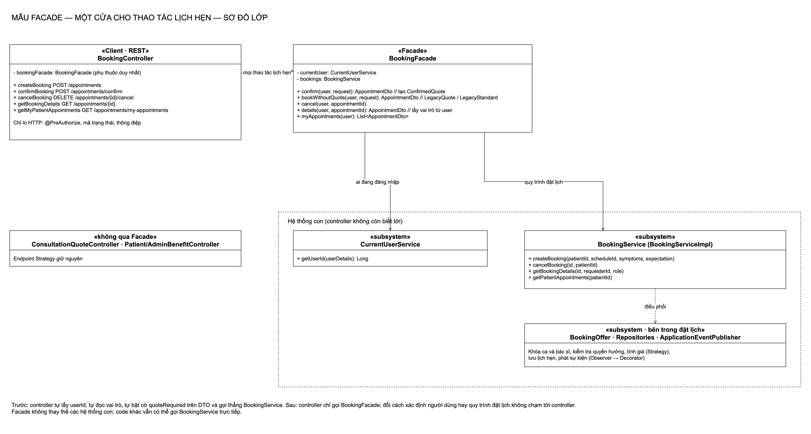
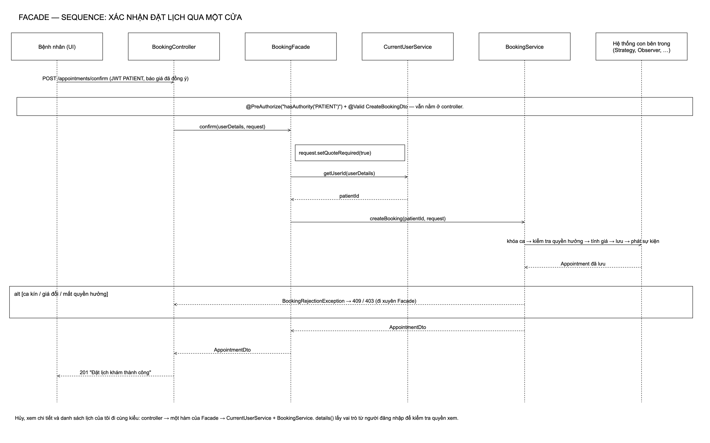
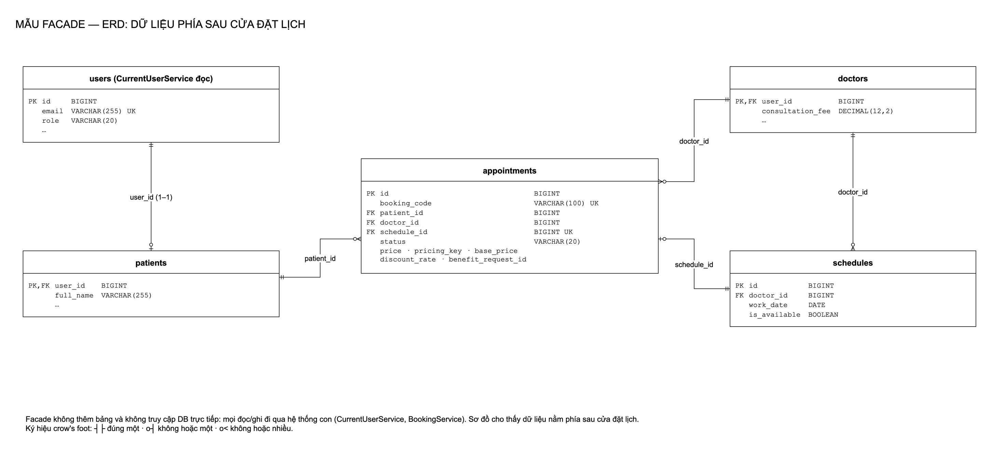
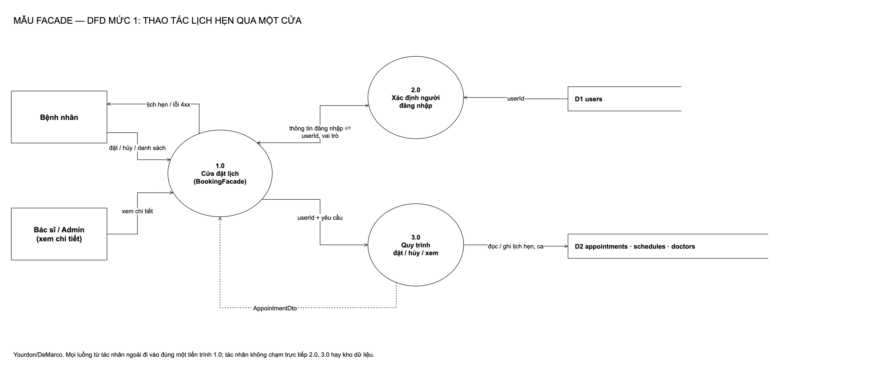
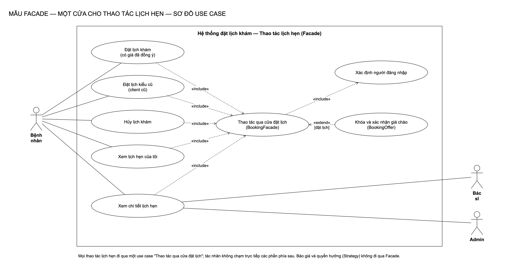

# Facade: một cửa cho thao tác lịch hẹn

[← Bản đồ 7 mẫu](../README.md) · [Kịch bản thuyết trình](kich-ban-thuyet-trinh.md)

## 1. Mẫu Facade là gì

Facade là mẫu **cấu trúc (structural)** trong GoF: *cung cấp một giao diện thống nhất cho một tập giao diện trong hệ thống con; Facade định nghĩa giao diện cấp cao hơn để hệ thống con dễ dùng hơn.*

| Thành phần | Vai trò |
|---|---|
| **Facade** | Cửa duy nhất, biết gọi hệ thống con nào, theo thứ tự nào |
| **Subsystem classes** | Làm việc thật; không biết Facade tồn tại |
| **Client** | Chỉ nói chuyện với Facade |

Ví dụ ngoài đời: quầy lễ tân phòng khám. Bệnh nhân chỉ nói "tôi muốn khám", lễ tân lo kiểm tra giấy tờ, tra lịch bác sĩ, thu phí; bệnh nhân không cần đi từng phòng.

## 2. Bài toán trong hệ thống

**Trước:** `BookingController` phụ thuộc `BookingService` và `CurrentUserService`, và tự làm việc của tầng dưới:

- tự đổi `UserDetails` thành userId ở mọi endpoint;
- tự đọc vai trò từ `getAuthorities()` khi xem chi tiết;
- tự bật `request.setQuoteRequired(true)` ở luồng xác nhận.

Controller vừa lo HTTP vừa lo cách dùng dịch vụ; đổi cách xác định người dùng là sửa controller.

**Phương án đã cân nhắc:**

| Phương án | Vì sao không chọn |
|---|---|
| Giữ nguyên | Logic dùng dịch vụ rải ở 5 endpoint |
| Dồn vào `BookingService` | Dịch vụ đặt lịch phải biết `UserDetails` của Spring Security |
| **Facade giữa controller và dịch vụ** | Controller chỉ còn HTTP; Facade gom cách dùng hệ thống con |

## 3. Thiết kế

| Vai trò | Lớp | Ghi chú |
|---|---|---|
| Client | [`BookingController`](../../backend/src/main/java/com/datlichkhambenh/backend/controller/BookingController.java) | Chỉ tiêm `BookingFacade`; giữ `@PreAuthorize`, mã trạng thái, thông điệp |
| Facade | [`BookingFacade`](../../backend/src/main/java/com/datlichkhambenh/backend/facade/BookingFacade.java) | `confirm` (tạo `ConfirmedQuote`), `bookWithoutQuote` (tạo `LegacyQuote` / `LegacyStandard`), `cancel`, `details`, `myAppointments` |
| Subsystem | `CurrentUserService` | `UserDetails` → userId |
| Subsystem | `BookingService` / `BookingServiceImpl` | Khóa ca, quyền hưởng, tính giá (Strategy), lưu, phát sự kiện (Observer) |

Các controller Strategy (báo giá, quyền hưởng) **không** đi qua Facade để giữ nguyên phần đã kiểm thử kỹ.

## 4. Sơ đồ

| Class | Sequence |
|---|---|
|  |  |

| ERD | DFD |
|---|---|
|  |  |

**Use case**

Nguồn `.drawio` trong [diagrams/](diagrams/), sinh bằng `python3 scripts/facade/generate-diagrams.py`.

## 5. Quyết định thiết kế

1. **Facade nhận `UserDetails`, dịch vụ nhận userId.** Phụ thuộc Spring Security dừng ở Facade.
2. **Facade quyết định kỳ vọng của bệnh nhân** (từ 11/11/2026): route `/confirm` luôn thành `ConfirmedQuote`, route cũ thành `LegacyQuote` hoặc `LegacyStandard`; `BookingOffer` kiểm tra theo kỳ vọng đó. Thay cho cờ `quoteRequired` trên DTO trước đây.
3. **Lỗi đi xuyên Facade.** `BookingRejectionException` (409/403) không bị bọc lại, để `GlobalExceptionHandler` trả đúng mã như trước.
4. **Facade không thay thế hệ thống con.** Code khác (test, job sau này) vẫn gọi `BookingService` trực tiếp được.
5. **Phủ cả 5 endpoint**, gồm `POST /appointments` cũ cho client chưa gửi báo giá.

## 6. Kiểm thử

| Test | Chứng minh |
|---|---|
| [`BookingFacadeIntegrationTests`](../../backend/src/test/java/com/datlichkhambenh/backend/facade/BookingFacadeIntegrationTests.java) | Qua API: xác nhận đặt lịch ra lịch CONFIRMED giá STANDARD; endpoint cũ vẫn đặt được; `/confirm` thiếu báo giá → 400; hủy rồi thấy CANCELLED trong danh sách; chủ lịch và bác sĩ xem được chi tiết, bệnh nhân khác bị chặn |
| Hợp đồng đặt lịch Strategy (`BookingPricingContract` và các lớp con) | Pass nguyên vẹn sau khi controller chuyển sang Facade |

## 7. Hạn chế

- Ngoài việc tạo kỳ vọng, các hàm còn lại chủ yếu chuyển tiếp; giá trị nằm ở chỗ gom kiến thức "dùng dịch vụ thế nào" ra khỏi controller.
- Nếu Facade phình ra (thêm báo giá, quyền hưởng…) nó dễ thành "god object"; vì vậy giữ phạm vi đúng 5 thao tác lịch hẹn.
