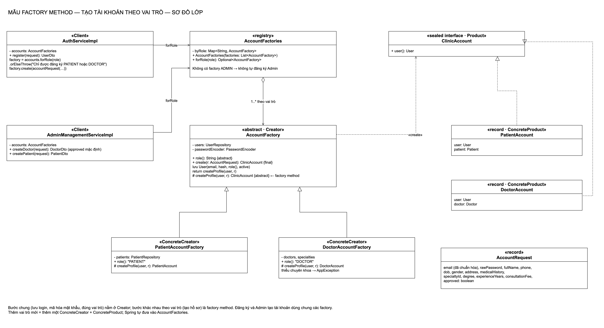
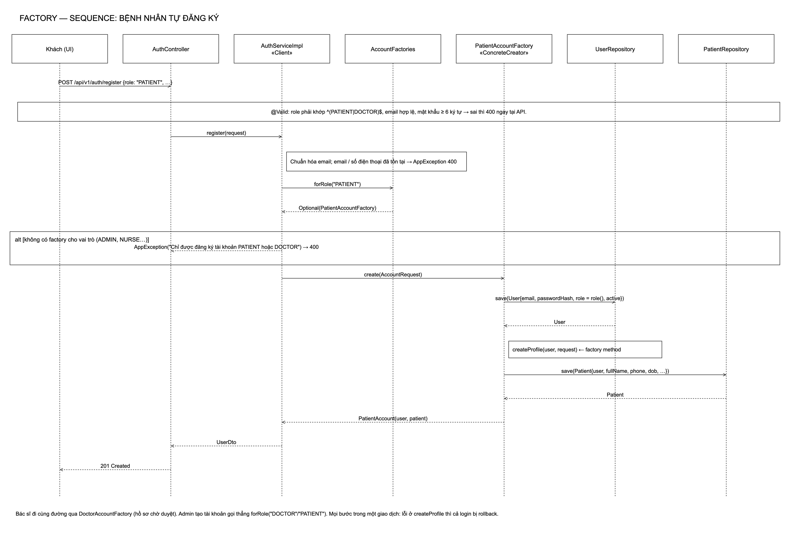
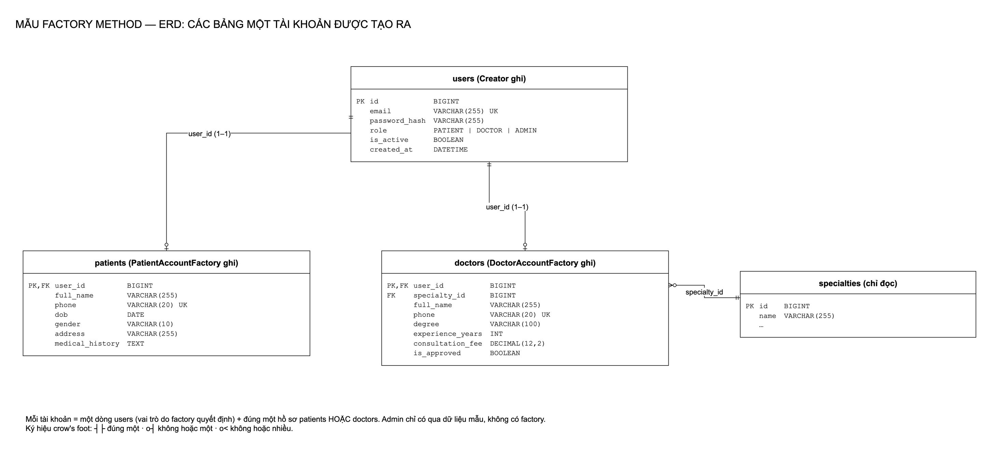
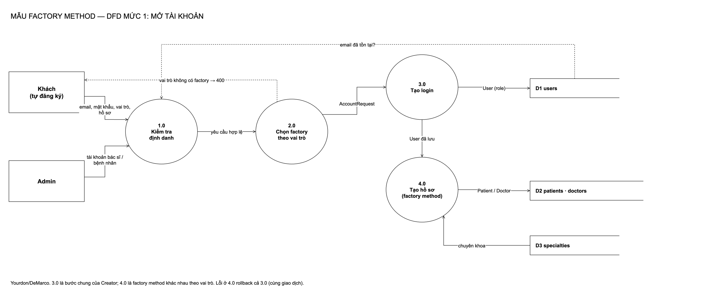

# Factory Method: tạo tài khoản theo vai trò

[← Bản đồ 7 mẫu](../README.md) · [Kịch bản thuyết trình](kich-ban-thuyet-trinh.md)

## 1. Mẫu Factory Method là gì

Factory Method là mẫu **khởi tạo (creational)** trong GoF: *định nghĩa một giao diện để tạo đối tượng, nhưng để lớp con quyết định tạo lớp nào; cho phép lớp cha hoãn việc khởi tạo sang lớp con.*

| Thành phần | Vai trò |
|---|---|
| **Creator** | Lớp cha có phần quy trình chung và khai báo factory method |
| **ConcreteCreator** | Lớp con cài factory method, tạo sản phẩm cụ thể |
| **Product** | Giao diện chung của sản phẩm |
| **ConcreteProduct** | Sản phẩm cụ thể |

Ví dụ ngoài đời: quầy mở thẻ ở bệnh viện. Thủ tục chung (lấy CMND, chụp ảnh, cấp mã) giống nhau; bước cuối khác nhau: thẻ bệnh nhân ghi tiền sử, thẻ bác sĩ ghi chuyên khoa.

## 2. Bài toán trong hệ thống

**Trước:** tạo tài khoản lặp ở ba chỗ:

- `AuthServiceImpl.register`: một khối `if PATIENT … else if DOCTOR …`, mỗi nhánh tự dựng `User` rồi hồ sơ;
- `AdminManagementServiceImpl.createDoctor` và `createPatient`: lặp lại việc dựng `User`, mã hóa mật khẩu, gán vai trò.

Thêm vai trò mới (ví dụ y tá) phải sửa cả ba chỗ; chỉ một chỗ quên gán vai trò là sinh lỗ hổng.

**Phương án đã cân nhắc:**

| Phương án | Vì sao không chọn |
|---|---|
| Hàm tiện ích `createUser(...)` | Gom được bước chung nhưng nhánh `if` theo vai trò vẫn nằm ở nơi gọi |
| Simple Factory (một lớp có `switch(role)`) | Thêm vai trò vẫn phải sửa `switch` |
| **Factory Method + danh bạ theo vai trò** | Bước chung ở Creator, bước riêng ở lớp con; thêm vai trò = thêm lớp, Spring tự đưa vào danh bạ |

## 3. Thiết kế

| Vai trò | Lớp | Ghi chú |
|---|---|---|
| Creator | [`AccountFactory`](../../backend/src/main/java/com/datlichkhambenh/backend/factory/AccountFactory.java) | `create()` (final): lưu `User` với mật khẩu đã mã hóa và `role()`; gọi `createProfile()` |
| ConcreteCreator | [`PatientAccountFactory`](../../backend/src/main/java/com/datlichkhambenh/backend/factory/PatientAccountFactory.java) | Hồ sơ bệnh nhân |
| ConcreteCreator | [`DoctorAccountFactory`](../../backend/src/main/java/com/datlichkhambenh/backend/factory/DoctorAccountFactory.java) | Hồ sơ bác sĩ, bắt buộc chuyên khoa, `approved` theo yêu cầu |
| Product | [`ClinicAccount`](../../backend/src/main/java/com/datlichkhambenh/backend/factory/ClinicAccount.java) | sealed interface, hai record `PatientAccount`, `DoctorAccount` |
| Đầu vào | [`AccountRequest`](../../backend/src/main/java/com/datlichkhambenh/backend/factory/AccountRequest.java) | Dùng chung cho đăng ký và Admin |
| Danh bạ | [`AccountFactories`](../../backend/src/main/java/com/datlichkhambenh/backend/factory/AccountFactories.java) | `forRole(role)`; không có factory ADMIN |
| Client | [`AuthServiceImpl`](../../backend/src/main/java/com/datlichkhambenh/backend/service/impl/AuthServiceImpl.java), [`AdminManagementServiceImpl`](../../backend/src/main/java/com/datlichkhambenh/backend/service/impl/AdminManagementServiceImpl.java) | `register()` chỉ còn một dòng tạo tài khoản |

## 4. Sơ đồ

| Class | Sequence |
|---|---|
|  |  |

| ERD | DFD |
|---|---|
|  |  |

Nguồn `.drawio` trong [diagrams/](diagrams/), sinh bằng `python3 scripts/factory/generate-diagrams.py`.

## 5. Quyết định thiết kế

1. **Không có factory cho ADMIN.** Vai trò chỉ hợp lệ khi có factory, nên dù lớp kiểm tra đầu vào bị vượt qua, đăng ký vẫn không tạo được Admin. Thông báo lỗi giữ nguyên như trước.
2. **`create()` là `final`.** Lớp con không thể bỏ bước mã hóa mật khẩu hay gán sai vai trò.
3. **Duyệt bác sĩ là tham số, không phải lớp riêng.** Tự đăng ký → chờ duyệt; Admin tạo → đã duyệt (Admin vẫn chọn được "chờ duyệt").
4. **Kiểm tra email/số điện thoại trùng giữ ở service.** Đăng ký và Admin có thông báo lỗi khác nhau; factory chỉ lo dựng tài khoản.
5. **Mọi bước trong một giao dịch.** Lỗi ở `createProfile` (ví dụ chuyên khoa không tồn tại) rollback cả login.

## 6. Kiểm thử

| Test | Chứng minh |
|---|---|
| [`AccountFactoryIntegrationTests`](../../backend/src/test/java/com/datlichkhambenh/backend/factory/AccountFactoryIntegrationTests.java) | Qua API: bệnh nhân đăng ký → đăng nhập được, có hồ sơ; bác sĩ đăng ký → vào danh sách chờ duyệt; thiếu chuyên khoa → cùng lỗi cũ; Admin tạo bác sĩ (đã duyệt / chờ duyệt) và bệnh nhân → đăng nhập được, tên được cắt khoảng trắng; ADMIN qua API → 400, không tạo user; gọi thẳng service với ADMIN / NURSE / admin → cùng lỗi, không tạo user |
| [`AuthServiceImplTests`](../../backend/src/test/java/com/datlichkhambenh/backend/service/AuthServiceImplTests.java) | Test cũ: chỉ đổi lời gọi constructor để truyền danh bạ factory |

## 7. Hạn chế

- `AccountRequest` gom cả trường của bệnh nhân lẫn bác sĩ; factory nào bỏ qua trường không dùng.
- Client nhận `ClinicAccount` rồi ép kiểu về `DoctorAccount`/`PatientAccount` khi cần hồ sơ cụ thể.
- `AuthServiceImpl` vẫn giữ vài phụ thuộc không còn dùng (để không phải sửa test cũ thêm lần nữa).
