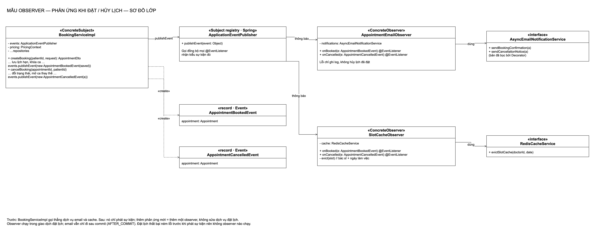
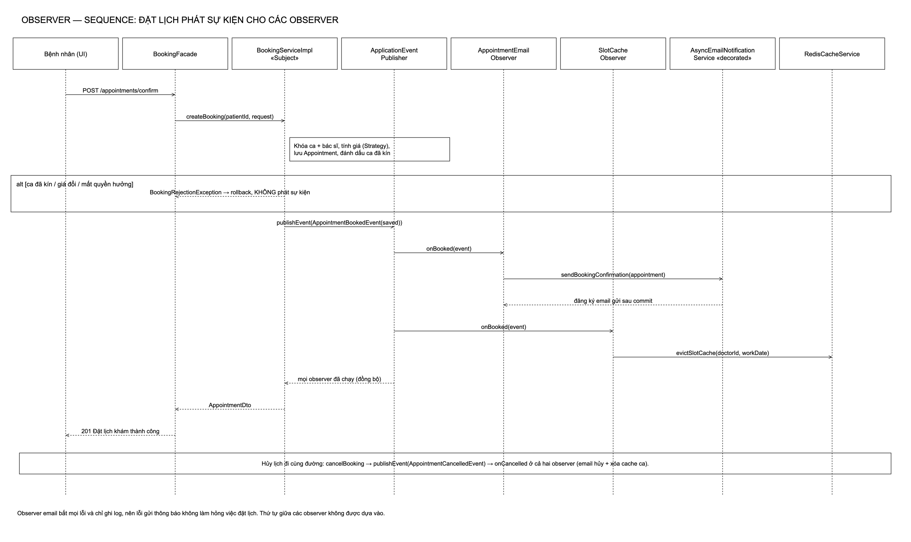
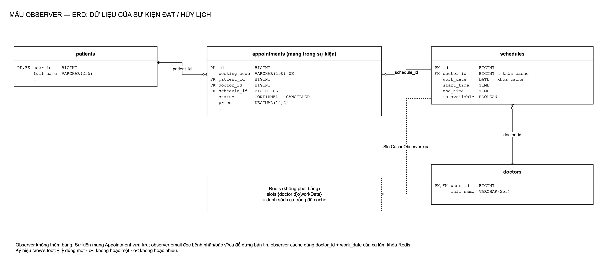
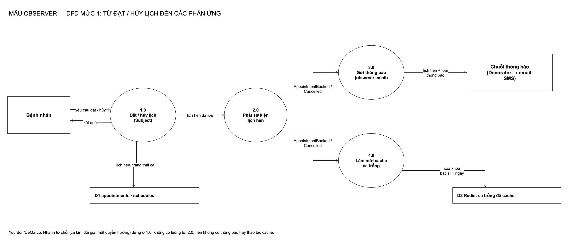
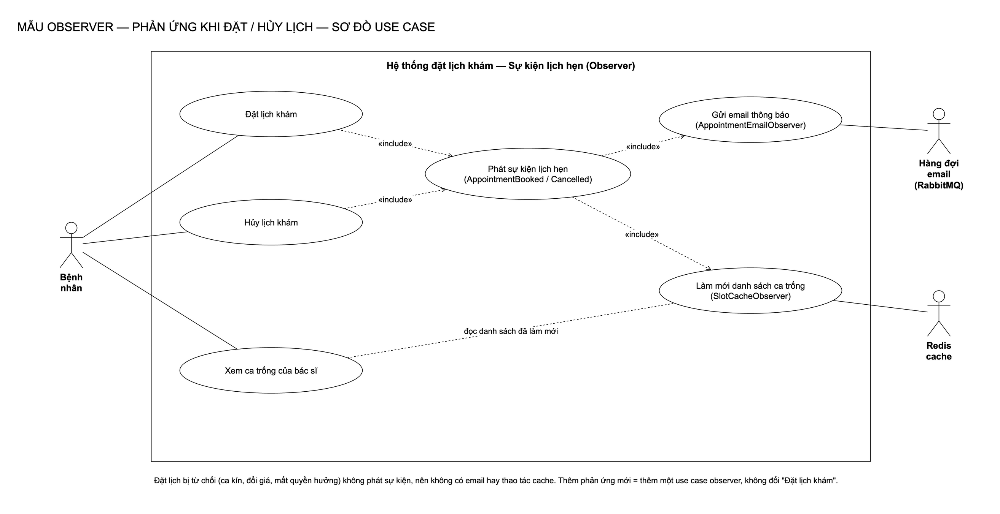

# Observer: phản ứng khi đặt / hủy lịch

[← Bản đồ 7 mẫu](../README.md) · [Tài liệu chi tiết](tai-lieu-observer.md) · [Kịch bản thuyết trình](kich-ban-thuyet-trinh.md)

## 1. Mẫu Observer là gì

Observer là mẫu **hành vi (behavioral)** trong GoF: *định nghĩa quan hệ một–nhiều giữa các đối tượng, để khi một đối tượng đổi trạng thái thì mọi đối tượng phụ thuộc được báo và tự cập nhật.*

| Thành phần | Vai trò |
|---|---|
| **Subject** | Nơi trạng thái thay đổi; giữ danh sách observer và báo cho họ |
| **Observer** | Giao diện "nhận thông báo" |
| **ConcreteObserver** | Mỗi lớp là một phản ứng cụ thể |

Ví dụ ngoài đời: đăng ký kênh YouTube. Kênh (Subject) đăng video thì mọi người đăng ký (Observer) đều nhận thông báo; kênh không cần biết ai đăng ký.

## 2. Bài toán trong hệ thống

**Trước:** `BookingServiceImpl` sau khi lưu lịch hẹn tự gọi `redisCacheService.evictSlotCache(...)` rồi `emailNotificationService.sendBookingConfirmation(...)`; hủy lịch cũng vậy.

- Dịch vụ đặt lịch phụ thuộc trực tiếp email và cache, dù việc của nó chỉ là đặt lịch.
- Muốn thêm một phản ứng (gửi SMS, ghi thống kê…) phải mở và sửa dịch vụ đặt lịch, vốn có khóa, tính giá, nhiều nhánh lỗi.

**Phương án đã cân nhắc:**

| Phương án | Vì sao không chọn |
|---|---|
| Giữ gọi trực tiếp | Mỗi phản ứng mới là một lần sửa dịch vụ đặt lịch |
| Tự viết danh sách listener trong Subject | Làm lại thứ Spring đã có, phải tự lo đăng ký/hủy |
| `@TransactionalEventListener(AFTER_COMMIT)` cho observer | Observer chạy ngoài giao dịch: mất khả năng ghi lịch sử thông báo cùng giao dịch (Decorator cần) |
| **Sự kiện miền + `@EventListener` của Spring** | Spring giữ danh sách observer; observer chạy đồng bộ trong giao dịch; email vẫn đi sau commit nhờ cơ chế có sẵn |

## 3. Thiết kế

| Vai trò | Lớp | Ghi chú |
|---|---|---|
| ConcreteSubject | [`BookingServiceImpl`](../../backend/src/main/java/com/datlichkhambenh/backend/service/impl/BookingServiceImpl.java) | Chỉ còn `events.publishEvent(...)`; không còn phụ thuộc email và cache |
| Danh sách observer | `ApplicationEventPublisher` (Spring) | Gọi đồng bộ mọi `@EventListener` khớp kiểu sự kiện |
| Sự kiện | [`AppointmentBookedEvent`](../../backend/src/main/java/com/datlichkhambenh/backend/observer/AppointmentBookedEvent.java), [`AppointmentCancelledEvent`](../../backend/src/main/java/com/datlichkhambenh/backend/observer/AppointmentCancelledEvent.java) | record mang lịch hẹn vừa lưu |
| ConcreteObserver | [`AppointmentEmailObserver`](../../backend/src/main/java/com/datlichkhambenh/backend/observer/AppointmentEmailObserver.java) | Gửi xác nhận / thông báo hủy; lỗi chỉ ghi log |
| ConcreteObserver | [`SlotCacheObserver`](../../backend/src/main/java/com/datlichkhambenh/backend/observer/SlotCacheObserver.java) | Xóa cache ca trống của bác sĩ + ngày |

## 4. Sơ đồ

| Class | Sequence |
|---|---|
|  |  |

| ERD | DFD |
|---|---|
|  |  |

**Use case**

Nguồn `.drawio` trong [diagrams/](diagrams/), sinh bằng `python3 scripts/observer/generate-diagrams.py`.

## 5. Quyết định thiết kế

1. **Phát sự kiện ở cuối, sau mọi kiểm tra.** Nhánh từ chối (ca kín, đổi giá, mất quyền hưởng) ném lỗi trước khi phát, nên không observer nào chạy, không email, không xóa cache.
2. **Observer email tự bắt lỗi.** Trước đây lời gọi email nằm trong `try/catch`; observer giữ đúng hành vi đó để lỗi thông báo không làm hỏng việc đặt lịch.
3. **Không có observer ghi log riêng.** Ghi lịch sử thông báo thuộc về Decorator; ranh giới: Observer quyết định *khi nào, ai phản ứng*; Decorator quyết định *gửi thông báo thì thêm hành vi gì*.
4. **Không dựa vào thứ tự giữa các observer.** Email và cache độc lập; nếu sau này cần thứ tự thì dùng `@Order`.

## 6. Kiểm thử

| Test | Chứng minh |
|---|---|
| [`AppointmentObserverIntegrationTests`](../../backend/src/test/java/com/datlichkhambenh/backend/observer/AppointmentObserverIntegrationTests.java) | Qua API: đặt lịch → đúng 1 email và 1 lần xóa cache đúng bác sĩ + ngày; hủy → 1 email hủy + 1 lần xóa cache; đổi giá / mất quyền hưởng / ca kín → không email, không xóa cache |
| [`BookingServiceImplTests`](../../backend/src/test/java/com/datlichkhambenh/backend/service/BookingServiceImplTests.java) | Test cũ: nay kiểm tra hủy lịch **phát** `AppointmentCancelledEvent` (trước kiểm tra gọi email, collaborator đã bị bỏ có chủ đích) |

## 7. Hạn chế

- Luồng điều khiển khó lần theo hơn: đọc `BookingServiceImpl` không thấy ngay ai phản ứng.
- Observer chạy đồng bộ: một observer chậm làm chậm việc đặt lịch.
- Observer cache dựa vào việc `RedisCacheServiceImpl` tự bắt lỗi Redis; một observer mới ném lỗi chưa bắt sẽ làm hỏng cả giao dịch đặt lịch, nên mỗi observer phải tự lo lỗi của mình.
